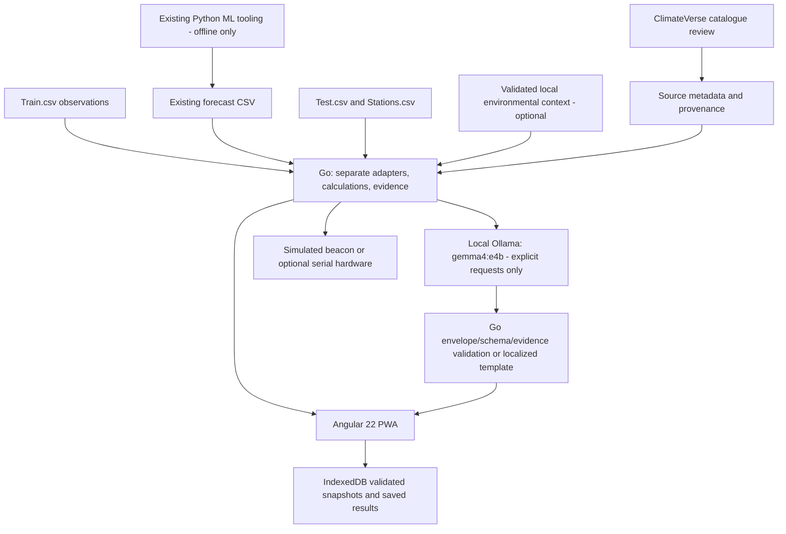

# Mumbai Air Guardian: evidence-based implementation plan

## Current public-demo deployment note (internal)

The judge-facing README and submission PDF include the intended URL `https://air.hackmum.in` and the public-demo availability caveat. This documentation is not evidence that the endpoint is deployed or verified.

Cloud deployment remains a separate post-submission workstream. Do not upload the excluded competition inputs while their redistribution rights are unconfirmed. The present service serves the API only and is loopback-bound; confirm a compliant data-serving approach, externally configurable API origin, and frontend/static hosting behavior before deployment. `gcloud` was not available in the verified environment; no cloud deployment command was run. Track operational preparation and verification in `docs/PUBLIC_DEMO_OPERATIONS.md`.

## 1. Executive summary

Build the complete prototype beside the existing competition work, not by modifying it. Preserve all 85 files in `D:\Projects\air-guardian\zindi_artifacts`. Use the existing Python work only as offline forecasting lineage; the application runtime is Go, Angular 22, optional local Ollama/Gemma, and optional Arduino.

This root file is the **approved implementation contract and live execution record**, incorporating the user's **APPROVED PLAN WITH EXECUTION REFINEMENTS** and subsequent editorial corrections. Those refinements take precedence over conflicting earlier phase dependencies or capability claims. The user has approved execution; Phases 1–3 gates have passed, including a reviewed local English Gemma response; Phase 4 localization's automated/representative smoke gate and Phase 6 simulation/API/UI/protocol gate have passed. Phase 5 PWA/sharing acceptance is complete. The user has approved accessibility and language acceptance; audit limitations are recorded in Phase 7. The judge-facing README and 10-page PDF are finalized and validated locally; the PDF is 795,140 bytes, below the 10 MB limit. Challenge-form upload is a separate submission action. Arduino firmware and physical transport remain unverified.

Keep this root file current with toolchain status, milestone results, verified capabilities, deviations, blockers and exact test commands/results. Use the capability labels **IMPLEMENTED**, **SIMULATED**, **OPTIONAL**, **PLANNED** and **UNAVAILABLE**. A feature described here is **PLANNED**, not IMPLEMENTED, until demonstrated. Record optional-service failures separately from application liveness.

Confirmed product decisions:

- The user selected `zindi_artifacts\submission_xgb_corrected_scale_110.csv` as the application's forecast input. This is a product selection, not evidence that it won a leaderboard comparison.
- Add an **optional preferred start time**. When provided, compare that duration-length period with the optimal valid period. Without it, return the optimal period without calculating or displaying an improvement/comparison metric.
- **Go computes all new activity recommendations.** Without Internet, local Go can still calculate. If Go itself is unavailable, the PWA displays saved results only; there is no second browser-side planner.

The highest-risk data issue is resolved: observations are hour-ending, and the timestamp embedded in every Test/submission ID also denotes the interval end. Join predictions to `Test.csv` by ID and use its explicit interval columns; never interpret an ID's timestamp as the interval start.

The local inputs support an honest, fixed competition-data product, not a live monitoring service. The supplied observations end at **10 November 2026, 09:00 IST**. Forecast intervals extend through **20 November 2026, 23:00-24:00 IST**. Forecast issuance time is not recorded. Display **Challenge forecast snapshot**, **Latest observation in supplied dataset** and **Forecast generation time unavailable**. Never describe these archived values as live, current conditions, real-time readings or today's latest readings.

Go and a compatible Node 22 release are core implementation prerequisites. Ollama availability is a separate capability/claim gate, not a global implementation prerequisite: defer its investigation until Phase 3, finish and test deterministic fallbacks, and continue unrelated work if the existing runtime remains unavailable. Do not replace the approved stack or manufacture successful integrations.

### Execution record at this revision

This record reflects verified installations and current product checks; update it as additional milestones pass.

| Item | Recorded state | Required execution action |
| --- | --- | --- |
| Go | **IMPLEMENTED prerequisite:** verified official stable Go 1.27.4 installed user-locally at `%LOCALAPPDATA%\Programs\Go\go1.27.4\go`; no system `PATH` change | Command verified `go version go1.27.4 windows/amd64`; official archive SHA-256 `178ab98950ac69ab25069307dc6ade79f3816e414cce95b4da166a115cde1e7e`. Invoke by absolute executable path during this session. |
| Node/npm | **Angular-compatible user-local runtime:** Node 22.23.5 / npm 10.9.9 at `%LOCALAPPDATA%\Programs\node-v22.23.5`; official archive SHA-256 `4a191082e9706866830379d577d2cc8a50c776fcd9436a8d061b063ed0d9a0e3`. The existing system Node 22.20.0 remains installed. A WinGet/MSI update to 22.23.5 did not finish after 15 minutes; the elevated Windows Installer process could not be stopped from this session. Use the verified user-local runtime explicitly for project tooling. |
| Angular | Stable 22.2.6 compatibility verified during planning; no app installed | Use stable Angular 22, recheck compatibility, record resolved versions and retain `package-lock.json`. Do not initialize Git just to commit it. |
| Modern Web Guidance | **IMPLEMENTED prerequisite/review:** version 1.0.0 installed successfully with `npx.cmd modern-web-guidance@latest install`; GitHub Copilot skill copied to `.agents\skills\modern-web-guidance`, recorded in `skills-lock.json`, active-agent integration detected. Installer reported Safe / Low Risk with one alert. Relevant accessibility, form-validation, responsive-table and responsive-design guidance was retrieved and documented in `docs\MODERN_WEB_REVIEW.md`; manual assistive-technology and accessibility-tool checks remain outstanding. |
| Ollama/Gemma | **OPTIONAL:** local `gemma4:e4b` returned reviewed English responses that passed validation through the API and browser after the prompt revision. Earlier attempts timed out or returned invalid output. | Keep the deterministic fallback and 30-second limit; do not substitute another model or imply that every response is correct. |
| Phase 1 data loader | **IMPLEMENTED; MILESTONE GATE PASSED** | Pinned, typed data loader/configuration/tests and timestamp documentation. Formatting, module tidy, uncached tests, vet and package builds all pass against all approved inputs. |
| Core product and templates | **PHASE 2 GATE PASSED** | Go planner, trajectory, HTTP API, Angular Air Pulse, fixed-snapshot provenance, chart/table, station selection and activity-planning flow are implemented. |
| Localization | **PHASE 4 GATE PASSED** | English/Marathi/Hindi resources, typed runtime locale switching, document `lang`/title updates, locale-aware display formatting and selected-language explanation requests are implemented. All three resources pass key/placeholder parity; 26 Angular tests and representative browser locale-switch smoke checks pass. The user reviewed the Marathi and Hindi introductions and each language's activity planner/result/template explanation. Signed-comparison wording was subsequently corrected and needs review; other Marathi/Hindi wording remains unreviewed. |
| PWA and sharing | **IMPLEMENTED:** production offline snapshot restore and exact saved-result replay verified; sharing/clipboard acceptance remains pending | IndexedDB snapshots and exact saved-plan/explanation replay, sharing/copy UI and production service-worker asset caching exist. Stubbed copy/share success and failure paths were checked, but native-share completion and actual clipboard writing remain unverified. |
| Air Beacon | **SIMULATED:** verified-forecast preview, explicit diagnostic action and v1 protocol are implemented; simulation tests pass. Arduino firmware is **PLANNED**; physical mode is **OPTIONAL/unverified**. | No serial port is opened or scanned. The simulation makes no hardware or sensor claim. |
| Python/artifacts | Existing files preserved; 85-file aggregate fingerprint reverified | No Python/environment/lockfile changes, training or fetch scripts. The aggregate still matches `83adadccdfd2155e59abbf0b77053873a1c9982710728e6d981c75861123845b`. |
| Requested execution model | Copilot Fusion High requested by the user; no model switch performed | Select/verify it in the app before execution; this agent cannot change its own model through the exposed tools. |
| Backend dependency | `gopkg.in/yaml.v3 v3.0.1` selected from Go module metadata | Strict known-field YAML decoder; `go.mod`/`go.sum` are maintained by Go tooling. |

### Phase 1 execution record — milestone gate passed

- **IMPLEMENTED:** root implementation record; source manifest with exact four authorized inputs, pinned source digests/row counts, already-applied 1.10 declaration and unknown forecast generation time; strict startup risk-band validation; source-specific Go CSV parsing; station/sensor and interval join validation; raw observation quality-flag retention and explicit summary exclusion reason; six-clock-independent timestamp normalization; ClimateVerse catalogue/provider role metadata.
- **IMPLEMENTED:** `docs\TIMESTAMP_SEMANTICS.md` documents hour-end rules, ID example, latest observation/forecast boundary, no-link chart intent and source limitations.
- **IMPLEMENTED:** official stable Go 1.27.4 installed user-locally. The Python environment and all challenge assets are untouched.
- **IMPLEMENTED:** validation code/tests pass and full 48,400-row observation plus 2,592-row forecast ingestion succeeds against the registered SHA-256 digests and schemas.
- **Correction from direct re-verification:** `Stations.csv`'s earlier planning-note digest had a transcription error. The computed digest is `383269fa04abf8f2eb49e5ec0bb5a77c2df11acb6aca996b7edf269a109ee9cf`; the complete 85-file aggregate still matches the pre-implementation fingerprint `83adadccdfd2155e59abbf0b77053873a1c9982710728e6d981c75861123845b`. Only the manifest/planning transcription was corrected; the source asset was not modified.
- **Verified commands in `backend` (Go 1.27.4):** `go fmt ./...` PASS; `go mod tidy` PASS; `go test -count=1 ./...` PASS (`internal/airdata`, `internal/config`, including complete artifact-backed load); `go vet ./...` PASS; `go build ./...` PASS.
- **Dependency:** `gopkg.in/yaml.v3 v3.0.1`, pinned in `backend\go.mod` and `backend\go.sum`.
- **DEVIATION resolved by evidence:** observation `available_at` values use both RFC3339 `T` and space separators. The parser accepts both explicit-offset formats without using either as model issuance evidence.
- **Artifact preservation check:** 85-file relative-path/content aggregate is unchanged at `83adadccdfd2155e59abbf0b77053873a1c9982710728e6d981c75861123845b`.
- **PLANNED:** HTTP server, UI, PWA, Ollama requests, localization and beacon are not implemented in Phase 1.
- **UNAVAILABLE:** no verified runtime/model/hardware capabilities have been claimed. Optional weather is disabled pending separate validation.

### Phase 2 execution record — Go core and Angular Air Pulse implemented; milestone gate passed

- **IMPLEMENTED:** six-hour least-squares trajectory calculation over actual forecast timestamps; missing-hour gaps are omitted rather than extending the clock window, and fewer than two usable points remain unavailable.
- **IMPLEMENTED:** deterministic activity planner using the post-observation selected forecast only, whole-hour durations, complete contiguous coverage, arithmetic means, earliest tie resolution within `1e-9`, optional preferred-time comparison and the exact Malad regression.
- **IMPLEMENTED:** local Go HTTP composition at `127.0.0.1:8080`; health, station, bounded observation/forecast range, air-outlook, activity-plan, source, context, AI-status and beacon-status routes. Liveness stays healthy when optional services are unavailable. Request JSON is strict and capped at 16 KiB; CORS is explicit; responses carry no-store and baseline security headers; server timeouts and graceful shutdown are configured.
- **IMPLEMENTED:** source-backed HTTP tests prove the 15:00-17:00 Malad recommendation (`52.5801715` ug/m3), and confirm comparison data is absent when no preferred time was requested. API route, time-range, CORS, payload-size and capability-status tests pass.
- **Verified commands in `backend` (Go 1.27.4):** `go fmt ./...`, `go mod tidy`, `go test -count=1 ./...`, `go vet ./...` and `go build ./...` all PASS. A live local HTTP smoke check returned `/api/health` status `ok` and the real-data 15:00-17:00 plan with no comparison field.
- **IMPLEMENTED:** Angular Air Pulse provides fixed-snapshot provenance, four-station selection, hourly metrics and trajectory, gap-preserving chart with semantic table alternative, honest capability status and validated Go-backed activity planning. New plans are computed only by Go; preferred-time comparison remains optional.
- **Verified commands in `frontend` (user-local Node 22.23.5):** `node .\node_modules\@angular\cli\bin\ng.js build` PASS; `node .\node_modules\@angular\cli\bin\ng.js test --watch=false` PASS (**2 files, 6 tests**). A live browser preview loaded the supplied data; selected form defaults were 06:00, 20:00, two hours and no preferred start. Clearing the required date produced associated inline help/error text and focused the invalid field on submission.
- **IMPLEMENTED:** focused guidance review in `docs\MODERN_WEB_REVIEW.md`; required-field feedback is deferred until blur/submission, errors are associated with fields, the skip link targets a programmatically focusable main landmark, and the interval table remains keyboard-scrollable and semantically structured.
- **IMPLEMENTED:** root `README.md` documents the local Windows API/UI startup, toolchain requirements, test commands, data semantics, capability status and limitations. The live preview loaded real data and previously completed a Go-backed activity plan without a preferred-time comparison.
- **At the Phase 2 checkpoint:** Ollama/Gemma, weather context and physical beacon were unavailable; beacon simulation had not yet been implemented. See the later Phase 3 and Phase 6 records for current status.
- **Prerequisite correction:** the system-wide Node 22.20.0 installer remained in its Windows Installer transaction without completion after 15 minutes; stopping the exact elevated `msiexec` process was denied. To avoid bypassing Angular's engine check, verified the official Node 22.23.5 ZIP against its published SHA-256 and installed it under the user profile. This compatible Node 22 runtime and npm 10.9.9 are used by absolute path; no major version or global PATH change was made.
- **Modern Web Guidance prerequisite/review:** the requested installer command completed successfully with CLI package version **1.0.0**. It installed `.agents\skills\modern-web-guidance\SKILL.md` and `skills-lock.json`; the active environment was detected as GitHub Copilot. The installer reported one security alert rated Low Risk. Searches/retrievals covered accessible field errors, focus behavior, semantic data tables and responsive design; implementation choices and limitations are recorded in `docs\MODERN_WEB_REVIEW.md`. The user-local system Node upgrade did not replace Node 22.20.0, so the project invokes the verified user-local Node 22.23.5 runtime directly.
- **Overall Phase 2:** **GATE PASSED**. Go checks, Angular build/tests, accessible core-flow validation, live source-backed preview and reproducible local run instructions are recorded. Manual assistive-technology checks are still required during final hardening.

### Phase 3 execution record — explicit explanation and deterministic fallback implemented

- **IMPLEMENTED:** `POST /api/explain?lang=en|mr|hi` uses the Go planner and evidence builder; `GET /api/ai/status` reports the existing local Ollama model without making application liveness depend on it. English generation is explicit, bounded, and validated; Marathi/Hindi use localized deterministic templates.
- **IMPLEMENTED:** Angular now offers **Explain this plan** only after a successful Go plan. Station/form changes clear stale results, never auto-request generation, and do not change the Go-computed values. A visible polite status and labeled template/Gemma result are presented as text.
- **IMPLEMENTED:** deterministic fallback and client tests cover timeout, invalid/malformed output and localized templates. One timeout test now bounds its mock handler lifetime.
- **Verified in `backend` (Go 1.27.4):** `go test -count=1 -timeout=2m ./...`, `go vet ./...` and `go build ./...` PASS.
- **Verified in `frontend` (user-local Node 22.23.5):** `ng test --watch=false` PASS (**2 files, 7 tests**) and production `ng build` PASS.
- **Verified local browser smoke:** source-backed Malad plan for 12 November 2026 returned 15:00–17:00 IST and mean PM2.5 52.58017149999995; only then did the explicit click return the deterministic fallback. The output retained fixed-snapshot caveats and did not add comparison data.
- **Gemma status:** earlier explicit requests returned `generation_timeout` and `invalid_model_output`. The prompt now specifies the same required phrases enforced by validation and asks for complete sentences, while retaining the numerical and safety restrictions and changing the prompt/cache version.
- **Real-model verification, 12 November 2026:** with the user's existing local `gemma4:e4b`, the normal API returned a reviewed English `mode: gemma` response for a Shivaji Nagar plan with preferred-time comparison in 15.83 seconds. The browser's explicit action also returned a reviewed `Gemma-generated` explanation for the Malad plan. Both preserve the fixed-snapshot/issuance/uncertainty limitations and leave the Go plan authoritative. Hindi returned its intended localized template. A successful sample does not establish semantic correctness for every request or prevent later timeouts.
- **Reviewed API evidence:** response hash `fc152cb56e1c8fd8b6e2b882f17e440da053d9875371bf3949edd27d04b2b30b`; summary: "The selected period has the lowest mean among complete forecast windows in the selected range." Action: "The Go-computed result should be used for a relative forecast comparison." Limitations: "This represents a fixed snapshot and is not live; the forecast issuance time is unavailable, and uncertainty is not quantified."
- **Unavailable-service check:** with a temporary unreachable loopback Ollama endpoint and a three-second test timeout, API health remained `ok`, AI status was `unavailable`, and the explanation returned `mode: template` with `reasonCode: ollama_unavailable`. The normal configuration still defaults to 30 seconds; the user's Ollama service was not stopped.
- **Verification after prompt revision:** backend `go test -count=1 -timeout=2m ./...`, `go vet ./...` and `go build ./...` pass; focused tests cover the prompt/validator requirements and reject missing forecast, action and issuance limitations. The 85-file artifact fingerprint remains `83adadccdfd2155e59abbf0b77053873a1c9982710728e6d981c75861123845b`.
- **Health/status correction:** `/api/health` reports the implemented deterministic explanation fallback as available; `/api/ai/status` separately reports local model availability.
- **Modern Web Guidance:** `forms` guidance informed the native explicit-action button and polite asynchronous status. The focused result and remaining manual accessibility checks are recorded in `docs\MODERN_WEB_REVIEW.md`.
- **Overall Phase 3:** **IMPLEMENTATION/FALLBACK AND REAL-GEMMA SAMPLE GATES PASSED.** Preserve the explicit fallback and report model and language limitations.

Phase 1 and Phase 2 strict gates have passed; the Phase 3 implementation/fallback gate and Phase 4 localization gate have passed. Continue PWA/sharing acceptance and beacon simulation by their actual dependencies rather than an artificial phase-number chain. Keep all seven milestone identities, preserve P0 throughout, and disable a regressing P1/P2 feature in the demo instead of letting it break P0. Disabled or unfinished features retain honest labels.

## 2. Repository inventory

### Scope and method

The folder contains 85 files, totaling 51,347,065 bytes: 50 CSVs, 25 Python files, two PNGs, one notebook, one ZIP, and six documentation/environment files. All files, including hidden entries, were enumerated. CSV headers and row counts were inspected; primary observation, prediction, and weather data were profiled; ZIP members were inspected without extraction; relevant scripts, notebook explanations, environment metadata, and timestamp/forecast writers were examined without execution.

There is no `.git` directory, application, virtual environment, `forecast_runs` directory, saved model binary, run manifest, or existing application test suite. Git status/history and tracked/ignored status therefore cannot be established. The copied `.gitignore` supplies patterns, not proof of Git tracking.

Inventory authority below means authoritative **for the stated use**, not a claim that a candidate model is the most accurate. All paths are relative to `D:\Projects\air-guardian`.

### Primary challenge inputs

| Exact path | Classification; important schema | Rows | Application use and authority |
| --- | --- | ---: | --- |
| `zindi_artifacts\Train.csv` | Observations: `timestamp_ist, pm25, mean, count, available_at, location_id, sensor_id, station_name, series_id, flag_high_1000` | 48,400 | Selected observation source; latest supplied and a strict superset of older snapshots. Preserve flags and gaps. |
| `zindi_artifacts\Train_Oct31.csv` | Older observation release; same schema | 47,116 | Audit/reference only. Its latest measurement is 22 October despite its filename. |
| `zindi_artifacts\Train_Nov8.csv` | Older observation release; same schema | 47,849 | Audit/reference only; latest measurement 2 November, 23:00 IST. |
| `zindi_artifacts\Train_Nov9.csv` | Older observation release; same schema | 48,133 | Audit/reference only; per-station latest measurements vary on 9 November. |
| `zindi_artifacts\Test.csv` | Target metadata, not observations: `ID, location_id, sensor_id, target_start_ist, target_end_ist, scoring_block, unit` | 2,592 | Authoritative ID-to-station/interval join for all forecasts. No measured targets. |
| `zindi_artifacts\SampleSubmission.csv` | Submission template: `ID, Target` | 2,592 | Planning audit/reference only, not a runtime data input. All Target cells are blank. |
| `zindi_artifacts\Stations.csv` | Station metadata: `location_id, station_name, selected_sensor, latitude, longitude, timezone` | 4 | Authoritative canonical station mapping; matches all expected locations. |
| `zindi_artifacts\DataDictionary.txt` | Definitions, source semantics, evaluation schedule | N/A | Primary local authority for measurement intervals, units, and provenance limitations. |
| `zindi_artifacts\AdditionalHistory.zip` | Auxiliary observations and source-specific metadata | 7 members | Preserve; not needed by the initial runtime. No authoritative cross-source station mapping is supplied. |

Archive members, inspected in place:

| Member | Schema/meaning | Rows | Reuse decision |
| --- | --- | ---: | --- |
| `History_Mumbai_2018_2020.csv.gz` | `StationId, Datetime, PM2.5`, other pollutants/AQI, station metadata and flags | 87,717 | Historical source IDs/intervals differ; do not merge into current observations. |
| `History_Mumbai_2024.csv.gz` | `station_id, collected_at, timestamp_ist, value, unit, source, series_id`, flags | 216,472 | Averaging intervals not fully aligned to current targets; exclude from initial runtime. |
| `Legacy_Observations_2020_2022.csv.gz` | `location_id, sensors_id, datetime, value`, coordinates and provenance | 12,452 | Irregular samples, not qualified current hourly labels; exclude. |
| `Other_Mumbai_Stations_2025_2026.csv.gz` | `sensor_id, timestamp_ist, mean, count, available_at, location_id`, provenance/flags | 9,125 | Auxiliary stations, not extra forecast locations; exclude from geographic coverage. |
| `XKDR_All_Stations.csv` | Source-specific station IDs, coordinates, source and coverage metadata | Not used | Lookup only, including locations outside Mumbai. |
| `Kaggle_All_Stations.csv` | `StationId, StationName, City, State, Status` | Not used | Lookup only; IDs are not interchangeable with OpenAQ IDs. |
| `HistoryNotes.txt` | Source attribution, interval and cross-source caveats | N/A | Authoritative archive limitations; retain attribution to CPCB/CAAQMS, OpenAQ, XKDR and Rohan Rao/CPCB-derived data. |

### All generated submission candidates

Every file below contains exactly 2,592 `ID,Target` rows, preserves the Test ID order, has unique IDs and finite non-negative predictions. None is an observation source.

| Exact path | Forecast/model-output purpose | Initial runtime decision |
| --- | --- | --- |
| `zindi_artifacts\submission_xgb_corrected_scale_110.csv` | Corrected predictions multiplied by 1.10, rounded to six decimals | **Selected by user; load as forecasts only.** |
| `zindi_artifacts\submission_xgboost_final_corrected.csv` | Unscaled corrected pooled XGBoost candidate | Lineage/reference; not selected. |
| `zindi_artifacts\submission_xgb_corrected_scale_090.csv` | Verified 0.90 multiple of corrected base | Candidate only. |
| `zindi_artifacts\submission_xgb_corrected_scale_095.csv` | Verified 0.95 multiple of corrected base | Candidate only. |
| `zindi_artifacts\submission_xgb_corrected_scale_105.csv` | Actually identical to the 1.10 file, not a 1.05 multiple | Filename discrepancy; preserve, do not auto-select or rename. |
| `zindi_artifacts\submission_xgb_corrected_scale_115.csv` | Verified 1.15 multiple of corrected base | Candidate only. |
| `zindi_artifacts\submission_xgb_corrected_scale_120.csv` | Verified 1.20 multiple of corrected base | Candidate only; current scaling script writes this file. |
| `zindi_artifacts\submission_xgb_corrected_station_hedge.csv` | Station-specific 0.90/0.95 scaling candidate | Candidate only. |
| `zindi_artifacts\submission_breeze_adjusted.csv` | Adjusted candidate; not one uniform scale of corrected base | Generator/run provenance not established; exclude. |
| `zindi_artifacts\submission_catboost_seasonal.csv` | CatBoost/seasonal candidate | Alternative model output; exclude. |
| `zindi_artifacts\submission_xgboost_4_stations.csv` | Station-specific XGBoost candidate | Alternative output; exclude. |
| `zindi_artifacts\submission_xgboost_diwali.csv` | Experimental festival candidate; maximum 140,076.03125 | Extreme output; no accuracy claim or runtime selection. |
| `zindi_artifacts\submission_xgboost_diwali_challenger.csv` | Experimental festival challenger | Historical generator/run identity unresolved; exclude. |
| `zindi_artifacts\submission_xgboost_diwali_clean.csv` | Cleaned festival candidate | Historical generator revision unresolved; exclude. |
| `zindi_artifacts\submission_xgboost_final.csv` | Earlier pooled final candidate | Superseded for this application's selection, not deleted. |
| `zindi_artifacts\submission_xgboost_grandmaster.csv` | Historical/spatial/weather experiment; maximum 1,244.750732 | Alternative output; exclude. |
| `zindi_artifacts\submission_xgboost_satellite_moonshot.csv` | Satellite-assisted experiment | Alternative output; exclude. |

No separate later/private-only final file or score/selection manifest was found. Validation results do not establish which scaling candidate was officially selected or performed best.

### Validation and overlap artifacts

These are generated evaluation artifacts, often containing both historical target columns and predictions. A `pm25` column does **not** make them authorized observation sources. Preserve all; reuse only as ML research/provenance context, not as app data or displayed forecast confidence.

| Exact path | Rows | Important schema/purpose |
| --- | ---: | --- |
| `zindi_artifacts\analog_validation_predictions.csv` | 657 | Observed targets, `hour_start/hour_end`, RF/analogue predictions, fold and blend |
| `zindi_artifacts\analog_validation_grid.csv` | 110 | `analog, analog_weight, rmse, rows`; tuning grid |
| `zindi_artifacts\analog_lofo_predictions.csv` | 657 | Predictions plus held-out-fold selections/coverage |
| `zindi_artifacts\analog_lofo_results.csv` | 4 | Held-out folds, selected analogue/weight, RMSE and coverage |
| `zindi_artifacts\climatology_validation_predictions.csv` | 657 | Targets, RF/ExtraTrees/hourly climatology predictions, fold/blend |
| `zindi_artifacts\climatology_validation_grid.csv` | 126 | Component/weight/RMSE tuning grid |
| `zindi_artifacts\climatology_lofo_predictions.csv` | 657 | Held-out-fold predictions and selected component/weight |
| `zindi_artifacts\climatology_lofo_results.csv` | 4 | Held-out-fold RF versus climatology RMSE |
| `zindi_artifacts\daniil_validation_predictions.csv` | 175 | Station/sensor, interval, observed `pm25`, baseline/RF/XGB predictions and errors |
| `zindi_artifacts\regime_validation_predictions.csv` | 175 | Station/sensor/start, target and regime/RF/XGB predictions |
| `zindi_artifacts\regime_weight_scan.csv` | 31 | Blend weight and RMSE |
| `zindi_artifacts\rolling_backtest_folds.csv` | 71 | Fold coverage, target statistics and model RMSEs |
| `zindi_artifacts\rolling_backtest_predictions.csv` | 11,280 | Historical targets, RF/ExtraTrees/climatology/blend predictions, fold |
| `zindi_artifacts\rolling_backtest_reliability.csv` | 20 | Model fold counts, mean/median/p90/worst RMSE and wins |
| `zindi_artifacts\rolling_backtest_stations.csv` | 282 | Per-fold/per-station row counts and RMSEs |
| `zindi_artifacts\rolling_backtest_oct_nov.csv` | 20 | Seasonal aggregate model RMSEs |
| `zindi_artifacts\rolling_backtest_xgb_folds.csv` | 71 | Fold diagnostics including XGBoost |
| `zindi_artifacts\rolling_backtest_xgb_predictions.csv` | 11,280 | Historical targets and candidate predictions including XGBoost |
| `zindi_artifacts\rolling_backtest_xgb_reliability.csv` | 21 | Model-level diagnostics including XGBoost |
| `zindi_artifacts\rolling_backtest_xgb_stations.csv` | 282 | Station/fold diagnostics including XGBoost |
| `zindi_artifacts\rolling_backtest_xgb_oct_nov.csv` | 21 | Seasonal diagnostics; does not evaluate the selected 1.10 artifact as such |
| `zindi_artifacts\test_train_overlap.csv` | 2,592 | Test metadata plus joined revealed observations/flags; derived audit, not the primary observation source |

### Environmental files

| Exact path | Rows | Schema; authority and use |
| --- | ---: | --- |
| `zindi_artifacts\open_meteo_weather.csv` | 61,536 | `time, temperature, humidity, precipitation, wind_speed, wind_direction, location_id`; four-point modeled context. Validate units/temporal semantics before enabling; issue-time lineage is missing. |
| `zindi_artifacts\mumbai_weather_cache.csv` | 18,456 | `time, temp, humid, wind_spd, wind_dir`; single Mumbai point, historical cache; not four station measurements. Exclude from initial selected-station context. |
| `zindi_artifacts\mumbai_weather_cache_v2.csv` | 16,272 | Same single-point schema; insufficient future coverage. Exclude from initial selected-station context/model-input claims. |
| `zindi_artifacts\satellite_no2.csv` | 507 | `date, satellite_no2`; daily regional Sentinel-5P-derived column, not PM2.5 or station-hour weather. Exclude from initial UI/evidence pending spatial/time/quality validation. |

### Python source, notebook, environment and documentation

Source files are offline tooling, not runtime dependencies. A script's presence establishes what it can produce, not that a particular command/version produced a supplied CSV.

| Exact path | Purpose; initial application reuse |
| --- | --- |
| `zindi_artifacts\train_xgboost_final_corrected.py` | Matching writer for corrected base: hour normalization, calendar/lag features, optional fully covered weather, XGBoost and validated export. Reference lineage only; do not execute. |
| `zindi_artifacts\train_xgboost_final_corrected_init.py` | Earlier corrected-writer revision; preserve for lineage, do not run. |
| `zindi_artifacts\generate_scaled_candidates.py` | Produces 0.90, 0.95 and station-hedge candidates, not the current 1.10 file; preserve. |
| `zindi_artifacts\scale_105.py` | Misleading filename: currently `SCALE = 1.20` and output is `submission_xgb_corrected_scale_120.csv`; preserve unchanged. |
| `zindi_artifacts\forecast_pipeline.py` | Leakage-aware offline pipeline with prospective run manifests, CV and issue-time-matched weather. Its `forecast_runs` outputs/manifests are absent; do not execute or substitute nonexistent forecasts. |
| `zindi_artifacts\train_xgboost_final.py` | Earlier pooled XGBoost/weather/interpolation workflow; historical only. |
| `zindi_artifacts\train_xgboost_diwali.py` | Station-specific festival XGBoost writer for `submission_xgboost_4_stations.csv`; historical only. |
| `zindi_artifacts\train_xgboost_grandmaster.py` | Historical/spatial/weather experiment; historical only. |
| `zindi_artifacts\train_xgboost_satellite.py` | Festival/satellite candidate writer; historical only. |
| `zindi_artifacts\zindi_mumbai_air_quality.py` | CatBoost/seasonal training, validation and submission workflow; historical only. |
| `zindi_artifacts\rolling_backtest.py` | Gap-aware historical rolling model evaluation; explicitly not a submission generator. |
| `zindi_artifacts\validate_analog_models.py` | Multi-fold station/city analogue experiments; not current-period evidence of historical similarity. |
| `zindi_artifacts\validate_climatology_models.py` | Multi-fold climatology/ExtraTrees/blend evaluation. |
| `zindi_artifacts\validate_daniil_models.py` | Baseline/calendar-model validation with challenge-style gaps. |
| `zindi_artifacts\validate_regime_models.py` | Gap-aware regime-correction experiments. |
| `zindi_artifacts\evaluate_analog_lofo.py` | Leave-one-fold-out analogue evaluation. |
| `zindi_artifacts\evaluate_climatology_lofo.py` | Leave-one-fold-out climatology evaluation. |
| `zindi_artifacts\evaluate.py` | Submission statistics/outlier/trend visualization; not proof of comparative accuracy. |
| `zindi_artifacts\evaluate_3.py` | Similar submission diagnostic plotting. |
| `zindi_artifacts\train_test_overlap.py` | Independently corroborates Train end-hour to Test start-hour alignment; writes derived overlap CSV if run. |
| `zindi_artifacts\cyclicaltimeseries.py` | Calendar features with explicit Train hour-end to hour-start conversion. |
| `zindi_artifacts\fetch_weather.py` | Four-coordinate Open-Meteo archive/forecast downloader; does not retain per-row issuance or retrieval metadata. Do not execute during app startup. |
| `zindi_artifacts\pull_satellite.py` | Authenticated Earth Engine Sentinel-5P regional extraction; do not invoke authentication or fetch data in the runtime. |
| `zindi_artifacts\starter_code.py` | Notebook-exported starter, CP1252 text with notebook magic; not an ordinary executable Python module. Preserve, do not repair as app scope. |
| `zindi_artifacts\main.py` | Small placeholder entry point; no application to reuse. |
| `zindi_artifacts\Mumbai_Air_Quality_Starter.ipynb` | Challenge starter explanations and baseline; corroborates intervals, missing-data and approximate-backtest caveats. Preserve outputs and cells. |
| `zindi_artifacts\pyproject.toml` | Offline Python project, requires Python >=3.12; dependencies are NumPy, pandas, scikit-learn and XGBoost. Do not expand/restore for app runtime. |
| `zindi_artifacts\uv.lock` | Locked NumPy 2.5.4, pandas 3.1.1, scikit-learn 1.9.1, XGBoost 3.4.1 and transitive dependencies; preserve. |
| `zindi_artifacts\.python-version` | Requests Python 3.12; installed inspector is Python 3.13.14. No environment changes were made. |
| `zindi_artifacts\.gitignore` | Python-generated files and `.venv` patterns; preserve. |
| `zindi_artifacts\README.md` | Empty; no existing product/setup documentation. Create a separate root README after approval. |
| `zindi_artifacts\evaluate3.png` | Generated ML diagnostic image; no application/UI mock authority. |
| `zindi_artifacts\Figure_1.png` | Generated ML diagnostic image; no application/UI mock authority. |

No trained model needs to be loaded or deserialized by Go.

## 3. Existing assets to reuse

Reuse `Stations.csv`, current `Train.csv`, `Test.csv`, and the user-selected 1.10 forecast as immutable inputs. Use `DataDictionary.txt`, starter explanations, corrected-writer code and archive notes as source documentation. Reuse weather only through an independently validated context adapter, never as invented evidence of the selected model's inputs.

The newer `forecast_pipeline.py` references a genuine ClimateVerse catalogue DOI at lines 884 and 921. That record was followed and its public metadata reviewed during planning. This is a real provenance/discovery use, but not proof that the pre-existing weather cache was originally downloaded through ClimateVerse.

Record input fingerprints in the application's source manifest. Principal SHA-256 values measured during planning:

| Input | SHA-256 |
| --- | --- |
| `Train.csv` | `8adbcf55315f166d7dc3dc1d3e4d7400651f26c1d8b95ff387eef38f4e70a283` |
| `Test.csv` | `e7b9cc8859beb939276c958393e148adae55229c34f99dcb2555fe4ac13b28db` |
| `Stations.csv` | `383269fa04abf8f2eb49e5ec0bb5a77c2df11acb6aca996b7edf269a109ee9cf` |
| `DataDictionary.txt` | `5e5f4dcf4a08067431e51c4c258da697385c49a5e49291fba2a9b92252c01d06` |
| `submission_xgb_corrected_scale_110.csv` | `f82875f5f6ce820fafea9e53ef93298f3a21c29d514bbad9caec260f17c907d4` |
| `submission_xgboost_final_corrected.csv` | `277940bb0e3ba289764d48b8605088b51c11d96e763f82373c86f8061aaa1126` |
| `open_meteo_weather.csv` | `1f2a483b3c4f62942b16b87f7f176d1e8b6134871593aa2674acc9b7879bb706` |

The complete 85-file relative-path/content inventory fingerprint is `83adadccdfd2155e59abbf0b77053873a1c9982710728e6d981c75861123845b`. Re-audit changed inputs rather than silently accepting a new release under an old manifest.

## 4. Selected observation source

Use **only `zindi_artifacts\Train.csv`** for the current four-station observed series.

- Concentration: `pm25`; `mean` is identical, not an independent signal.
- Time: `timestamp_ist`, with explicit `+05:30`, denotes the **end** of the hourly interval.
- Identity: `location_id` and `sensor_id`, checked against `Stations.csv`.
- Provenance: challenge-provided hourly OpenAQ-series data; retain `series_id`, sample count and diagnostic flags.
- `available_at` is the retained source-file modification time, **not** a verified first-publication time or model-generation timestamp (`DataDictionary.txt:11-12`).

All four stations begin at source hour-end `2025-02-19 03:00:00+05:30` and end at `2026-11-10 09:00:00+05:30`.

| Station ID | Rows | Latest observed PM2.5, ug/m3 | Missing hours within its full source span | `flag_high_1000` rows |
| --- | ---: | ---: | ---: | ---: |
| `11611` | 12,343 | 189.9333333333333 | 2,760 | 0 |
| `3409511` | 12,133 | 77.03999999999999 | 2,970 | 12 |
| `11606` | 12,241 | 50.425 | 2,862 | 4 |
| `3409510` | 11,683 | 43.802499999999995 | 3,420 | 3 |

The audit found no empty cells, invalid timestamps, non-finite or negative PM2.5, or duplicate station-hour records. Counts are three or four source readings. There are genuine missing periods; the largest gap is 243 missing hours. Raw concentrations include 19 flagged values above 1,000, with a maximum of 241,587.56333333335.

Preserve raw flagged measurements and expose a quality status and warning. Do not silently clamp, replace or reinterpret them as forecasts. Exclude explicitly flagged anomalies from ordinary evidence/trend summaries with an explicit exclusion count/reason; retain access to them in the observation table/diagnostic presentation. Do not remove unflagged values merely because they exceed 500.

All older Train snapshots are strict subsets of current Train, with no changed shared PM2.5 values; do not concatenate them. Submission/prediction files, validation files containing `pm25`, and the derived overlap CSV are **not** alternate observation inputs.

## 5. Selected forecast artifact

Use **`zindi_artifacts\submission_xgb_corrected_scale_110.csv`**, confirmed by the user after the audit disclosed the ambiguous candidates.

| Property | Finding |
| --- | --- |
| Shape | `ID,Target`; 2,592 rows, four stations, 648 rows per station |
| Values | Finite, non-negative; minimum 14.498868, maximum 595.318133, mean 63.85620019058642 ug/m3 |
| Identity | Exact Test/SampleSubmission ID set and order; no duplicates |
| Scaling | Numerically equals corrected-base Target x 1.10 to six-decimal rounding; maximum residual <=0.0000005 |
| Duplicate candidate | `submission_xgb_corrected_scale_105.csv` has the same content hash; its name is misleading |
| Interval resolution | One hour, from explicit Test start/end columns |
| Coverage | `[2026-10-22 00:00, 2026-10-24 00:00)` and `[2026-10-27 00:00, 2026-11-21 00:00)`, IST |
| Private evaluation portion | 11-12 November: 48 intervals per station, 192 total; not a separate private-only CSV |
| Historical overlap | 323/320/320/321 observed-overlap intervals for Malad/Borivali/Shivaji/Byculla respectively |
| Post-observation portion | 255 hourly intervals per station starting 10 November, 09:00 IST |
| Issuance metadata | `generatedAt`, exact training snapshot, execution command and run parameters are not recorded |

`train_xgboost_final_corrected.py` writes the matching unscaled base filename. Its defaults describe pooled XGBoost with calendar features and 72/96/120/168-hour lags, 600 trees, depth 6, learning rate 0.03 and seed 42. These are **script defaults, not a verified historical run manifest**. The precise command that created the supplied base and 1.10 variant is unresolved.

The supplied default weather-v2 cache misses 264 unique Test target hours, so the current corrected script would disable that weather input. Do not claim that the selected artifact used weather, satellite data or ClimateVerse features.

Enrich deterministically by joining `ID -> Test.csv -> Stations.csv`. Sort by interval start, because CSV row order is not chronological. Preserve predicted values unchanged; do not apply 1.10 again.

The primary forward chart/planner uses intervals at or after the latest observation end. Older overlapping predictions may be available only in an explicitly historical view; they must not be presented as evidence of out-of-sample performance or used to fill missing observations.

## 6. Four-station canonical mapping

Use location IDs as strings. Repository names, sensors, coordinates and `Asia/Kolkata` match the specification without discrepancies (`Stations.csv:2-5`).

| Canonical ID | Official name | Sensor ID | Latitude | Longitude |
| --- | --- | --- | ---: | ---: |
| `11611` | Malad West, Mumbai - IITM | `12236426` | 19.197090 | 72.822040 |
| `3409511` | Shivaji Nagar, Mumbai - BMC | `12238576` | 19.060498 | 72.923356 |
| `11606` | Borivali East, Mumbai - IITM | `12236418` | 19.232410 | 72.868950 |
| `3409510` | Byculla, Mumbai - BMC | `12238567` | 18.976700 | 72.838000 |

Load this mapping from the supplied metadata, validate the expected set and sensor links, and reject mismatches. Do not merge auxiliary archive IDs or treat numeric IDs as geographic ordering. Show four discrete markers, not a citywide heatmap.

## 7. Timestamp-semantics findings

**Measurement-interval semantics are resolved. Publication and forecast-issuance times are not.**

Evidence:

- `DataDictionary.txt:4-7,22` defines observation hour-end and explicit target intervals.
- Starter notebook section 2 and `starter_code.py:49-52` independently use Train end minus one hour.
- `train_xgboost_final_corrected.py:90-91` uses the same normalization.
- All 2,592 Test IDs were checked: their embedded timestamp equals `target_end_ist`, not `target_start_ist`.

Specific trap: `MUM_11611_20261027T0100_IST` joins to **27 October 00:00-01:00 IST**, not 01:00-02:00 (`Test.csv:2`). Do not parse that ID directly into a start-time forecast point.

Worked latest boundary:

| Item | Source representation | Normalized interpretation |
| --- | --- | --- |
| Final Malad observation | `Train.csv:24585`, `2026-11-10 09:00:00+05:30`, PM2.5 189.9333333333333 | Observation interval `[08:00,09:00)` IST; chart start 08:00; headline says hour ending 09:00 |
| First subsequent Malad forecast | `MUM_11611_20261110T1000_IST`, `Test.csv:347`, selected forecast row 347, Target 74.129998 | Forecast interval `[09:00,10:00)` IST; chart start 09:00 |
| Correct boundary | Last observation end = first forward forecast start | Vertical boundary **10 November 09:00 IST**, or 03:30 UTC |

Equivalent boundary values for the other stations are recorded at Test/forecast rows 947, 1547 and 2147. The latest observation end is 09:00 IST for all four.

Implementation rules:

- Retain `intervalStart`, `intervalEnd`, original source timestamp and timestamp semantics.
- Explicitly derive observation start = source end - one hour. This is an interval conversion, not a guessed timezone adjustment.
- Derive forecast start/end from the Test join, not from an extra shift.
- Use RFC3339 timestamps with offsets, `Asia/Kolkata` presentation and an embedded Go timezone database where necessary on Windows.
- Never infer model issuance or publication timing from file modification/copy times.
- Use separate solid observed and dashed forecast series with interval-aware tooltips and a marked boundary; never connect the two series artificially.
- Render missing hours as gaps. Do not bridge the 24-26 October forecast gap or historical measurement gaps.
- If replacement data lack proved semantics, quarantine that source or show separate timelines until revalidated.

Create `docs\TIMESTAMP_SEMANTICS.md` with these examples and regression tests.

## 8. Environmental/context data currently available

| Source | Classification | Established facts | Initial behavior |
| --- | --- | --- | --- |
| `open_meteo_weather.csv` | AVAILABLE BUT NEEDS VALIDATION | 15,384 hourly rows for each canonical station, 15 February 2025 through 17 November 2026, 23:00 IST; no duplicates/missing numeric fields | Optional context adapter. Enable only variables whose units/time support are documented; otherwise report unavailable. |
| `mumbai_weather_cache.csv` | AVAILABLE BUT NEEDS VALIDATION | One point at 19.0760,72.8777 in its writer, 1 October 2024 through 8 November 2026 | Not four-station context; exclude from initial evidence. |
| `mumbai_weather_cache_v2.csv` | AVAILABLE BUT NEEDS VALIDATION | Same single point, 1 January 2025 through 9 November 2026 | Stale for forward product dates; exclude. |
| `satellite_no2.csv` | AVAILABLE BUT NEEDS VALIDATION | 507 daily regional values, 15 February 2025 through 9 November 2026; Earth Engine writer identifies Sentinel-5P tropospheric NO2 | Not station PM2.5, not a causal explanation, not part of initial demo. |
| ClimateVerse catalogue metadata | AVAILABLE AND VERIFIED | Existing code DOI resolves to a public Climateverse India record for Open-Meteo; version 1.0, released 23 October 2026 | Save a minimal citation/provenance record during implementation; no fabricated data download or AI-search claim. |
| Land use, boundary-layer-height cache, current-period historical similarity | NOT PRESENT | No usable local values/calculation for these UI signals | Omit values and show unavailable where relevant. |
| Synthetic environmental fixtures | SYNTHETIC/DEMO ONLY | May be authored for isolated tests/sample mode after approval | Never silently substitute for real context. |

Public sources verified during planning:

- [ClimateVerse record](https://doi.org/10.71646/XXOBKO): **Open-Meteo historical weather, forecast and historical forecast APIs**, Open-Meteo, 2026, Climateverse India V1.
- [Record metadata](https://india.climateverse.net/api/datasets/:persistentId/?persistentId=doi:10.71646/XXOBKO): no hosted data files; the catalogue links to Open-Meteo and documents model/reanalysis limitations and source CC BY 4.0 terms.
- [Open-Meteo documentation](https://open-meteo.com/en/docs/historical-weather-api): default temperature Celsius, wind km/h, precipitation mm; most variables are instantaneous, but precipitation is a preceding-hour sum.

Consequences:

- Treat Open-Meteo values as **modeled environmental context**, not station measurements.
- The four-station file covers 576 of 648 Test target starts per station. The 72 intervals on 18-20 November lack this context; never forward-fill them.
- Its writer stitches archive and forecast responses but discards original issue/retrieval metadata. Label that limitation; do not claim the values were available when the PM2.5 forecast was issued.
- Validate the current files against the writer/provider definitions. For `WindSpeedMPS`, explicitly convert `m/s = km/h / 3.6`; preserve the source value, source unit, converted value and conversion provenance.
- Preserve precipitation's own preceding-hour interval; do not blindly align it as an instantaneous value or shift all weather variables together.
- Optional contextual display must identify valid time, temporal support, source and unknown issuance. Missing/ambiguous variables stay unavailable and out of Gemma evidence.
- The P0 product and all deterministic calculations work without weather.

Use `discoveredVia: "ClimateVerse India Portal"` for the catalogue review actually performed, with its DOI/version and planning-review stage. Do not retroactively label the pre-existing CSV's original discovery route as known. Do not describe the catalogue's metadata endpoint as a ClimateVerse-operated weather/forecast API.

## 9. Architecture validation

The approved architecture fits the available artifacts:



Default laptop topology: Go `127.0.0.1:8080`, development UI origin `http://localhost:4200`, configurable `API_BASE_URL=http://localhost:8080`, and Ollama loopback `http://localhost:11434`. Production can serve the built Angular assets from Go to reduce deployment/CORS complexity. Keep API-base configuration in one validated runtime configuration source, never scattered service literals.

Use standard `net/http`, immutable in-memory indexes loaded from validated local CSVs, and minimal dependencies: a maintained strict YAML parser and, for the optional real transport, `go.bug.st/serial`. No runtime Python, model loading, training, cloud AI, database server or Internet dependency.

Prerequisite evidence:

- npm registry exposes stable Angular/core and CLI **22.2.6**; do not use `next`/RC.
- [Angular compatibility](https://angular.dev/reference/versions) requires Node `^22.22.3 || ^24.15.0 || ^26.0.0`, TypeScript `>=6.0.0 <6.1.0`, and compatible RxJS. Installed Node is `22.20.0`; propose the least-disruptive supported Node 22 update after approval.
- Go is not on the inspected `PATH`. Search for an existing supported installation first; if absent, install a current maintained stable Go toolchain before Go acceptance commands and record the exact version/location. Do not substitute another backend language.
- Ollama client `0.40.9` exists, but reports an initialization warning and no reachable server. A direct `/api/tags` read at loopback was refused. Model presence/capabilities are unverified. Do not install Ollama or download a substitute model.
- `arduino-cli` is not on `PATH`; physical board/LED details are unknown and non-blocking for simulation.

HTTP safety: set read-header/read/write/idle timeouts, bound JSON requests and Ollama responses, propagate request cancellation, close resources, and implement graceful shutdown. A proposed baseline is 5-second header, 10-second read, 40-second write, 60-second idle limits, 16 KiB request bodies and 1 MiB Ollama bodies; keep the 30-second Ollama deadline within the write budget.

Use strict JSON/content-type/request validation, an explicit origin allowlist, and minimal status metadata. No client-supplied filesystem paths, provider URLs, prompts or authoritative evidence. Keep Ollama URLs operator-controlled and loopback by default. Reject untrusted origins for write actions; do not use wildcard CORS. Escape data/model text through Angular text rendering and safe chart/map APIs. Add appropriate CSP and content-type security headers; use HSTS only with HTTPS.

Optional LAN/phone mode remains P2. It needs explicit configuration, firewall documentation and trusted HTTPS for PWA/clipboard/share secure-context features. A phone loading the laptop's plain HTTP LAN IP does not inherit localhost's secure-context exception. Never expose Ollama directly.

## 10. Proposed Go package structure

Keep related domain types together rather than introducing a package for every struct:

| Package/path | Responsibility |
| --- | --- |
| `backend\cmd\server\main.go` | Composition, bounded startup, HTTP server, optional static assets and shutdown |
| `backend\internal\config` | Environment/YAML precedence, known-field parsing and validation |
| `backend\internal\airdata` | Typed stations, observations, forecast points, optional context, source manifests; **separate observation and forecast adapter files and entry points** |
| `backend\internal\outlook` | Risk bands, forecast peak/lowest period and trajectory |
| `backend\internal\activity` | One deterministic contiguous-window planner, optional preferred-period comparison |
| `backend\internal\evidence` | Source-backed bounded evidence and stable evidence hash |
| `backend\internal\gemma` | Ollama client, envelope/inner-schema validation, language checks, templates and bounded cache |
| `backend\internal\beacon` | Payload protocol, simulation, fake and optional real/isolated serial transport |
| `backend\internal\api` | Typed DTOs, routing, request limits, status/error mapping and dependency injection |

No forecasting library is needed. Normalize once at ingestion and index by station/time; do not reparse CSVs on each HTTP request. Query series by validated bounded time ranges.

### Risk-band safety

Validate a PM2.5 input as finite and non-negative **before** risk classification. Negative inputs must never enter classification or be clamped into the low band. Preserve raw valid observations and their quality flags separately from summary eligibility.

Prototype visualization bands are exactly low `[0,30]`, elevated `(30,60]`, high `(60,90]` and very high `(90,+infinity)`, in ug/m3. Every presentation includes the exact value, units, text label and icon/pattern; these are neither official AQI categories nor medical thresholds.

Strictly validate `config\risk-bands.yaml` at startup and reject negative lower bounds, non-finite finite bounds, a first lower bound other than zero, gaps, overlaps, invalid ordering or incorrect boundary inclusivity, missing colors, missing icons and missing beacon patterns. The last band is explicitly unbounded above; that does not admit non-finite PM2.5 inputs. Return a clear startup configuration error rather than silently repairing or defaulting malformed configuration.

Required routes. The canonical explanation endpoint contract is **`POST /api/explain?lang=en|mr|hi`**; `lang` is one selected value, not a literal pipe-delimited query value.

| Route | Contract |
| --- | --- |
| `GET /api/health` | Process liveness and independent capability flags; optional Ollama/Arduino/weather failures do not make a running app unhealthy |
| `GET /api/stations` | Four validated station records |
| `GET /api/stations/{id}/observations` | Observations only, interval/quality/provenance metadata |
| `GET /api/stations/{id}/forecast` | Selected artifact forecasts only, explicit intervals and unknown issuance |
| `GET /api/stations/{id}/context` | Available validated context or an explicit unavailable status/reason |
| `GET /api/stations/{id}/air-outlook` | Go-calculated peak, lowest period, bands and trajectory with coverage |
| `POST /api/activity-plan` | Validated hourly window/duration and optional `preferredStartTime` |
| `POST /api/explain?lang=en\|mr\|hi` | Station/time or activity reference; Go rebuilds authoritative evidence and calculates any plan |
| `GET /api/sources` | Public provenance, availability, hashes/limitations; no workstation paths |
| `GET /api/ai/status` | Minimal local model/provider/availability status; never triggers generation or model download |
| `GET /api/beacon/status` | Simulation/connection state, explicit failure reason and last payload |
| `POST /api/beacon` | Validated user-triggered update/test/settings action |

Return 400 for malformed requests/unsupported locale, 404 for unknown station, 422 for invalid or insufficiently covered activity periods, 413 for oversized requests, and 503 when required source capability is unavailable. A localized explanation fallback may return a normal explanation result only with explicit template generator/reason metadata.

Tag numeric/evidence records `observed`, `forecast`, `environmental_context`, `calculated` or `synthetic_sample`. AI prose is not a measurement and must not be mislabeled as a deterministic calculation: explanation objects separately identify `generator`, requested language and evidence hash. Simulation of hardware does not turn real forecast data into synthetic data.

## 11. Proposed Angular structure

Use a fresh standalone Angular 22 application with strict TypeScript and the CLI-supported test runner. Pin stable compatible versions and retain `package-lock.json`; exact installed versions go into the implementation record. No preview builds or framework substitution.

Structure:

- `frontend\src\app\core`: typed API client/runtime configuration, locale state, snapshot repository and sharing service.
- `frontend\src\app\features\air-pulse`: station selection, headline values, map, observed/forecast chart and freshness.
- `frontend\src\app\features\explain`: period/evidence view and explicit Explain button.
- `frontend\src\app\features\activity`: presets, allowed window, duration, optional preferred start, result and sharing.
- `frontend\src\app\features\beacon`: simulation, status, legend, steady-only option and explicit test controls.
- `frontend\src\app\features\sources`: source availability, classification, timestamps and limitations.
- `frontend\src\app\shared`: a small set of chart/map/status/provenance components.
- `frontend\src\assets\i18n`: committed `en.json`, `mr.json`, `hi.json`; configure asset copying explicitly.

Use Angular Material selectively for proven composite controls; Apache ECharts and Leaflet directly where practical, avoiding unnecessary wrappers. Lazy-load chart/map code where it helps the initial route. Bundle runtime assets locally; do not depend on font/script CDNs.

Air Pulse shows latest observed value/hour end, selected forecast, peak/time, lowest period, trajectory, units, sources and fixed-snapshot freshness. Do not derive live/current conditions from the computer clock or redate archived values. Use actual covered dates; after expiry, show an explicitly historical snapshot rather than manufacturing a new forecast.

Offline mapping must retain the four station markers/list, coordinates and attribution without assuming basemap tiles are cached. Do not bulk-cache map tiles contrary to provider terms. Provide a textual station selector and accessible data table so neither map nor canvas chart is the only access to information.

Build with accessibility in mind: landmarks, skip link, one page H1, meaningful titles, visible keyboard focus, labeled inputs/errors, predictable navigation, text/icons as well as color, reduced motion and readable Devanagari. Verify WCAG 2.2 AA contrast; prototype band colors are not automatically valid text colors. Do not render untrusted model/source strings as HTML.

**Modern Web Guidance:** its skill is available, but the project installer was intentionally not run in Plan mode. After toolchain setup and before frontend implementation, attempt `npx.cmd modern-web-guidance@latest install` for the active agent environment. Record success/failure, the installed version, active-agent integration and the exact failure if any in `IMPLEMENTATION_PLAN.md`; retry only once after correcting an actionable configuration problem. Installer failure does not block backend implementation. Consult relevant guidance before UI coding; use native browser features only where semantically appropriate and compatible with Angular. Perform the supported post-build guidance review and document findings, retained fallbacks, rejections and compatibility decisions in `docs\MODERN_WEB_REVIEW.md`; do not invent an unsupported review command or use a legacy scan as a substitute for the requested focused review.

## 12. Gemma/Ollama integration plan

Use only the existing local Ollama integration and model name `gemma4:e4b`. Configuration defaults: `OLLAMA_BASE_URL=http://localhost:11434`, `OLLAMA_MODEL=gemma4:e4b`, `OLLAMA_TIMEOUT_SECONDS=30`.

Attempt to verify or restore the existing service and exact model **when Phase 3 begins**, after Air Pulse and the activity planner work. Do not spend disproportionate effort troubleshooting it earlier. Do not reinstall Ollama, download another model, use a cloud provider, expose it directly to Angular/network clients or claim model presence based on the client executable.

Generation is explicit-user-action only. Station/time/language changes invalidate displayed evidence as appropriate but must not auto-generate.

Request a small structured evidence object, `stream:false`, a low-temperature final answer, and explicit JSON Schema through `format` where the local combination supports it. The model's permitted inner fields remain `summary`, `keySignals`, `recommendedAction`, `limitations`, `language`, with required types and `additionalProperties:false`.

Validation order:

1. Enforce request deadline/cancellation and HTTP success.
2. Read a bounded response and decode the Ollama envelope.
3. Extract final `message.content` for `/api/chat`; never return envelope reasoning/thinking fields.
4. Decode inner JSON strictly, rejecting trailing content, unknown fields, wrong types, missing/empty fields and oversized strings/arrays.
5. Check requested language, protected values/units/times/identifiers, and forbidden reasoning markers in purported final content.
6. Return only the validated final explanation or an explicit deterministic localized template.

Use generic JSON format only after a positively identified schema-format incompatibility, under the same overall timeout budget; do not repeatedly retry malformed/timeout responses.

Evidence is assembled by Go from registered data, not accepted as authoritative client text. Include actual interval support, quality exclusions, source limitations, unquantified uncertainty and already-computed activity results. Do not send whole CSVs, long histories or arbitrary user prompts.

Prevent numerical/time changes by supplying canonical protected tokens, validating returned factual tokens against the evidence and rendering authoritative numerical cards from Go values, not from model prose. Omission is preferable to an invented value. Schema/token checks cannot prove causal or linguistic correctness: adversarial fixtures and human smoke review remain necessary.

The prompt prohibits invented causes, causal claims from correlations, medical advice, forecast changes and activity-time selection. If context is insufficient, the explanation must say so.

Implement and test complete en/mr/hi fallbacks for stopped/unavailable model, timeout, malformed envelope/inner JSON, schema failure, evidence violation and invalid language. Label **Template-based explanation**, include a stable reason code, and log the failure without raw reasoning traces. Optional AI availability never changes `GET /api/health` liveness.

Separate the **implementation/fallback gate** from the **real-Gemma capability gate**. Once deterministic fallbacks and the bounded client/validation tests pass, unrelated P1/P2 work and submission-demo preparation may continue despite temporary Ollama failure. A genuine local, validated and reviewed response remains mandatory before the README, dossier or judging pitch claims that Gemma integration works. Until demonstrated, label real generation UNAVAILABLE/unverified and describe the fallback that actually works; passing fake-client tests does not establish a working model.

Use a bounded explanation cache keyed by canonical evidence hash plus language, model and prompt/schema version. Hash the source artifact identity, station, intervals, exact evidence values and deterministic configuration/results. Do not share English cache entries with Marathi/Hindi or retain explanations against changed inputs. Bound concurrency and memory; tests use injected fake HTTP responses only.

Reference: [Ollama structured outputs](https://docs.ollama.com/capabilities/structured-outputs), verified during planning. Local `gemma4:e4b` compatibility still requires a genuine integration check.

## 13. Activity-planner algorithm

### Request and validation

`ActivityRequest` contains `StationID`, `ActivityType`, `Date`, `EarliestStart`, `LatestEnd`, `DurationMinutes` and optional `PreferredStartTime`, with corresponding lower-camel-case JSON fields. A missing preferred start is represented distinctly from an explicitly invalid/empty value.

The initial UI permits whole-hour starts/ends and duration multiples of 60 only. Represent selected-day midnight ending as the following day's 00:00 where needed. Reject off-grid requests with a clear 422 error; do not silently round or interpolate.

Normalize offsets to IST, require a positive allowed interval/duration, and ensure the duration fits. A preferred start, when supplied, must be hourly aligned and its full duration must fit within the allowed range.

### Deterministic calculation

1. Select the station's forecast intervals from the configured artifact and sort by start.
2. Use half-open intervals `[start,end)` and an exact one-hour grid.
3. Consider every hourly start whose duration ends no later than the allowed end.
4. Require every hour of a candidate to exist, be valid and be contiguous; never bridge missing/duplicate hours.
5. Compute the arithmetic mean of the supplied hourly concentrations, without rounding intermediate values.
6. Choose the lowest mean; ties within a documented numerical tolerance of `1e-9 ug/m3` choose the earliest start.
7. Return interval, mean, source/evidence identity, resolution and unquantified forecast uncertainty.

Use prefix sums and coverage counts for a straightforward O(n) scan over the bounded search range. No weather weighting, medical scoring, interpolation or Gemma participation.

When preferred start is present, calculate its exact duration-length mean and return a comparison with `differencePm25 = recommendedMean - preferredMean`. A negative difference denotes a lower forecast. If that preferred period lacks complete forecast coverage, return a field-specific 422 response rather than inventing a baseline.

When preferred start is absent, **omit all preferred-period comparison fields from the API**, not even `comparison:null`. Omit preferred-window/mean, difference and improvement fields from both the serialized response and the UI/share text. Do not create a requested/preferred period, compare against the earliest period or average the entire allowed range. Prove this in a serialized API-response test as well as a planner test.

If no candidate is complete, return an explicit insufficient-coverage result, not a zero-valued recommendation.

### Real-data regression example

Fixed snapshot, not live advice: Malad `11611`, 12 November 2026, allowed 06:00-20:00 IST, duration 120 minutes, preferred 08:00-10:00.

- Thirteen complete candidates exist.
- Preferred mean: **86.1471275 ug/m3**.
- Lowest-forecast period: **15:00-17:00 IST**, mean **52.5801715 ug/m3**.
- Recommended-minus-preferred difference: **-33.566956 ug/m3**.

Use this source-backed calculation as a Go regression test with appropriate floating-point tolerance. Add a no-preference case that proves no comparison is emitted.

## 14. Trajectory algorithm

User-confirmed prototype method: least-squares slope against actual elapsed hours within the next **six clock-hour forecast interval starts** from the selected anchor. For an hourly anchor, consider only starts in `[anchor, anchor + 6 hours)`; do not extend the lookahead to replace missing points.

- Use at most six valid points; do not extend far into the future to hide missing hours.
- Fit using actual timestamps, not compressed array indices.
- Initial configurable threshold: `2 ug/m3 per hour`; slope >2 is worsening, <-2 improving, and inclusive [-2,2] stable.
- Report points used, time support and whether coverage is partial.
- Missing hours are omitted, never imputed; a partial result is labeled accordingly.
- Fewer than two valid distinct points means trajectory unavailable, not stable.
- Zero and constant forecasts are valid inputs.

Store method/lookahead/threshold with the risk configuration and include its version in relevant evidence/cache keys. This is a prototype display rule, not a medical threshold or validated prediction-confidence measure. Gemma never determines or changes trajectory.

## 15. Multilingual plan

Commit deterministic static resources at `frontend\src\assets\i18n\en.json`, `mr.json`, and `hi.json`. A lightweight typed locale service loads complete reviewed resources and updates document language/title, labels and formatting. No runtime LLM translation of static UI.

Cover all primary routes, activity presets and optional-preference labels, status/risk/source labels, validation/errors, offline notices, limitations, sharing and accessibility labels. Keep official station names/source identifiers unchanged.

Go owns separately versioned en/mr/hi dynamic fallback templates. The evidence's protected values are inserted deterministically. Cache identity includes locale.

For dynamic Marathi/Hindi, check matching `language`, meaningful primarily Devanagari prose, and preservation of numbers, time/unit tokens and identifiers. Allow Latin-script station/source/model names and technical abbreviations. Do not treat script detection alone as proof that Marathi versus Hindi is correct; use reviewed fixtures and readable smoke examples.

If localized generation fails, use the same locale's template, never silently switch to English. Include key-parity tests and a clear requirement for Marathi/Hindi human review before public production use.

## 16. PWA/offline plan

Angular service worker caches the application shell, bundled assets and all static locale resources. IndexedDB stores versioned, validated structured data, not arbitrary HTTP responses.

An atomic last-good snapshot includes station metadata, forecast series, a bounded recent-observation subset/quality metadata, source provenance and:

- `schemaVersion`, source/artifact hash, model name and actual station coverage;
- `dataType`, interval coverage and latest observation end;
- `generatedAt` **present but nullable**, with explicit unknown-issuance status when absent from the source;
- actual retrieval/cache timestamps, distinct from forecast issuance.

Do not fabricate `generatedAt` from import time or filesystem timestamps to satisfy the field list. Never store failed, partially parsed or invalid snapshots; retain the preceding validated snapshot if an update fails. Incompatible schemas/hashes are not silently mixed.

Store validated explanations under evidence/language keys and saved activity inputs/results under exact normalized inputs, including optional preferred time and source/configuration identity.

User-confirmed capability boundary:

- Internet absent, Go reachable: data loading, calculation and localized templates work locally; model works only if local Ollama is running.
- Go unreachable: show last-good observations/forecasts/provenance and saved activity results. **Do not calculate a fresh plan in TypeScript.**
- A saved result is labeled as saved, with its calculation/source time; do not relabel it as newly calculated.
- No matching saved result: show **New activity planning requires the local Air Guardian service. Previously saved plans remain available.** Include localized equivalents in the committed resources.

Show **OFFLINE SNAPSHOT**, source/coverage and actual retrieval time. If forecast issuance is unknown, say **Forecast generation time unavailable** instead of inventing a timestamp. Always warn that newer conditions may not be reflected. Distinguish stale data from network state using request outcomes, not `navigator.onLine` alone.

Do not cache POST calls automatically, local Ollama endpoints, arbitrary API failures or third-party map tiles.

Sharing uses a reviewed text preview and a direct user gesture. Use `navigator.share` where supported; treat cancellation normally without copying. For unsupported/technical failure, expose a separate **Copy plan** action with clear confirmation/error handling. Include station, IST interval, duration, mean, snapshot context and forecast/not-official-AQI/not-medical disclaimer. Include preferred-period comparison only when one exists.

## 17. Arduino/simulation plan

Implement in this order: **in-memory fake transport -> simulated beacon -> protocol and firmware -> optional physical serial transport**. The beacon is an output device, not a pollution sensor. Simulation is sufficient for the P1 differentiator.

Defaults: `ARDUINO_ENABLED=false`, empty serial port, baud `115200`, open timeout `500 ms`. Disabled, missing-port, failed-open and disconnected states must not block HTTP startup or make the whole app unhealthy. Report a precise status/reason, including **Serial port not configured** when applicable.

Use a transport abstraction with simulation, test fake and optional real implementation. Never scan COM ports automatically or during tests.

Verify the chosen serial library's Windows cancellation behavior. If open cannot be canceled directly, isolate it in a killable helper process of the same executable with a bounded readiness deadline and cleanup. An abandoned goroutine around a blocking Open is **not** an adequate timeout. If bounded abort/resource release cannot be demonstrated, defer physical mode instead of claiming it works.

Protocol: version-1 newline-delimited JSON at 115200 baud, with station, finite PM2.5, band, trajectory/status, peak hour, RGB and pattern. Bound line length and validate required fields. Surface last attempted/successful payload and ACK/ERR/disconnection state.

Firmware at `arduino\air-beacon\air-beacon.ino` uses ArduinoJson and a documented NeoPixel/RGB reference implementation with configurable pin/count. Parse complete bounded lines, reject malformed/unsupported messages, retain prior valid state, ACK valid input and ERR invalid input. Use a non-blocking `millis()` state machine, not delays.

Prototype state patterns: low steady; elevated one gentle pulse; high two; very high three, in a four-second cycle. Keep pulses gentle/non-strobing, with a separate diagnostic state and a steady-light-only accessibility option. Angular always supplies text/icon/status, including when pulses are disabled.

Actual board, LED type, pin, voltage/power and port are unknown. Document reference wiring as assumptions, not verified hardware. Physical compile/flash/wiring checks require the actual target; they do not block P0 or simulation.

## 18. Automated test matrix

All automated suites use local fixtures, `httptest`/fake clients and fake/simulated serial transport. They must not call the Internet, require Ollama or Arduino, enumerate physical ports or train models.

| Area | Focused tests that must fail without the safeguard | Expected location |
| --- | --- | --- |
| Source classification | Submission and mixed validation-prediction CSVs cannot become observations even when they contain `pm25`; explicit source registration and schema checks | `backend\internal\airdata\*_test.go` |
| Observations | Correct fields/intervals/sensor mapping; empty/malformed CSV; negative/non-finite values; duplicates; flags retained; gaps not filled | Same |
| Forecasts | Selected artifact joins Test by ID; unknown/missing/duplicate IDs; station/sensor mismatch; no repeated scaling; chronological sorting independent of file order | Same |
| Timestamp boundary | ID `20261027T0100` maps to 00:00-01:00; latest observed 08:00-09:00 and forecast 09:00-10:00 meet at 09:00 IST; UTC equivalents and replacement-source ambiguity | Same |
| Context | Four-station mapping, km/h-to-m/s conversion, precipitation interval support, missing 18-20 November context, unknown issuance and no filling | Same |
| Configuration/bands | 0/30/60/90 and values around boundaries; negative/non-finite inputs rejected before classification; negative lower bounds, gaps/overlaps/order/inclusivity; missing colors/icons/patterns rejected at startup | `config` and `outlook` tests |
| Outlook/trajectory | Peak/lowest period; positive/negative/threshold/zero slopes; missing hours; actual elapsed time; one/no points; partial-coverage labels | `outlook` tests |
| Activity | Native-hour contiguous windows; exact real-data example with floating-point tolerance; missing/duplicate hours; ties within 1e-9 choose earliest; duration/end-boundary rules; no valid candidate; preferred valid/invalid/missing coverage; **all comparison keys omitted from serialized API output when preference is absent** | `activity` and `api` tests |
| Evidence | Only registered facts and calculated outputs; no invented weather/causes; quality exclusions; source/config hash changes | `evidence` tests |
| Ollama envelope | Valid chat envelope; failed HTTP; oversized/truncated body; malformed outer JSON; empty/final content; reasoning fields never exposed | `gemma` tests |
| Explanation schema | Required fields/types, unexpected fields/trailing content, limits, empty summary, invalid locale/protected tokens/reasoning markers | Same |
| Failure/locales/cache | Unavailable/timeout/schema-format incompatibility/malformed content; en/mr/hi template provenance; no English fallback for mr/hi; language/evidence/config keys invalidate correctly | Same |
| API/lifecycle | Required routes/status codes, body limits, strict Origin/CORS, unsupported locale 400, invalid window 422, source unavailable 503, optional capability failures do not fail liveness, independent AI/beacon/source statuses, context cancellation/shutdown | `api` tests |
| Serial | Encoding/framing; disabled/missing port; fake blocked-open deadline and cleanup; ACK/ERR; invalid/disconnected transport; no scan | `beacon` tests |
| Angular services/components | Typed responses, observed/forecast labels and boundary; locale/key parity; optional preferred-time UI and no metric without it; errors/status/accessibility labels | CLI unit tests near source |
| Sharing | User-gesture invocation, cancel without copy, unsupported/technical-failure separate Copy action, clipboard failure, no medical claims and optional comparison text | Same |
| Persistence/PWA | Atomic validated snapshots, unknown generation timestamp, schema/hash compatibility, saved-result keys, cache update failure, SW/manifest configuration | Unit tests plus real-browser tests |
| Production browser flow | Real built app: Air Pulse, planner preferred/no-preference, explanation fallback, all locales; reload offline after warm cache; Go unavailable blocks new planning but retains saved plans; reduced motion and keyboard path | Minimal `frontend\e2e` Playwright suite |

Use Angular CLI unit tooling and add only the minimal browser-test support necessary to prove real service-worker/IndexedDB behavior. Browser tests use local app/Go fixtures and block external providers/tiles. Browser/dependency downloads are setup prerequisites, never implicit test-time network calls.

Phase-level commands, run from their stated directories after setup:

- Backend: targeted `go test` package selectors first; final `go test .\...` and `go build .\cmd\server`.
- Frontend: CLI-generated non-watch unit script, `npm run build`, and the defined local browser-test script.
- Firmware: protocol/transport tests always; compile for the actual/reference target only once board/core/library prerequisites are deliberately established.

Manual acceptance complements automation: keyboard-only use, contrast and focus inspection, screen-reader/table review, Devanagari readability, native share behavior and an Accessibility Insights pass. Do not call the UI fully accessible based on automated results alone.

## 19. P0/P1/P2 prioritization

| Priority | Scope |
| --- | --- |
| **P0 - MUST WORK FOR SUBMISSION** | Correct registered observation/forecast inputs; all four stations; proved interval semantics and source classification; provenance/freshness/unknown issuance; Go APIs; stable Angular Air Pulse/map/chart; deterministic planner including optional preference semantics; bounded Gemma path with a complete tested explicit deterministic fallback; local build and end-to-end demo; actual ClimateVerse catalogue attribution; essential keyboard/contrast/text status; judge-ready README, relevant-link preparation and verified dossier material. A working-Gemma claim additionally requires a genuine local response. |
| **P1 - STRONG DIFFERENTIATOR** | Complete en/mr/hi primary UI and dynamic explanations/fallbacks; installable PWA and last-good snapshots; saved offline plans; Web Share/Copy; beacon simulation; enhanced accessible risk/pattern presentation |
| **P2 - POLISH / DROP IF TIME IS SHORT** | Actual Arduino hardware session, optional LAN/phone hosting, advanced controls, extra animations/polish and optional context already supplied and independently validated; no new environmental signals or integrations beyond approved scope |

The full approved product includes P1; the P0 cut is a reliable demo checkpoint, not permission to call the entire specification complete. Preserve P0 at each milestone. Disable or remove a broken P1/P2 feature from the demo rather than letting it break P0, and record its actual state instead of claiming completion. Keep physical hardware optional and never let it delay Air Pulse/planning.

Execution priority is **DATA CORRECTNESS -> AIR PULSE -> ACTIVITY PLANNER -> GEMMA OR EXPLICIT FALLBACK -> SUBMISSION-READY DEMO -> P1 DIFFERENTIATORS -> P2 POLISH**. Do not add product scope: no new model training, selected-forecast changes, expanded geography/heatmap, sub-hour interpolation, authentication, database server, cloud AI, microservices, unnecessary deployment infrastructure, unvalidated environmental signals or historical-ML cleanup.

Risk bands remain prototype visualization rules: low `[0,30]`, elevated `(30,60]`, high `(60,90]`, very high `>90`. Show exact concentration, text and icon/pattern. Do not describe these as official AQI or medical thresholds.

## 20. Seven implementation phases with milestone gates

Keep the seven named phases below as reporting milestones, not an unconditional serialized dependency chain. **Phase 1 -> Phase 2 remains strictly gated**: no UI/AI implementation while source-classification, timestamp, station or provenance tests fail. Phase 3 begins only after the core product works.

After the Phase 3 implementation/fallback gate, establish the P0 submission-ready local-demo checkpoint: reproducible build/start instructions, verified functionality/provenance, honest AI status and draft submission material. This is not the final PDF. Then localization, PWA/IndexedDB/sharing and beacon simulation may progress independently where safe. Hardening/documentation can start at the P0 checkpoint; the final integrated hardening gate checks every enabled feature. Keep dependent contracts and localized notices consistent during integration. Genuine Gemma execution gates its capability claims, not unrelated implementation; physical serial verification never gates P0 or simulation.

### PHASE 1: DATA CORRECTNESS

**Objective:** establish immutable, source-typed ingestion and interval correctness before UI or AI.

**Files/packages:** root `IMPLEMENTATION_PLAN.md`; `backend\go.mod`, `go.sum`, initial server composition; `internal\config`, `internal\airdata`; `config\sources.yaml`, `config\risk-bands.yaml`, minimal ClimateVerse metadata; `docs\TIMESTAMP_SEMANTICS.md`; focused test fixtures.

**Dependencies:** execution approval; search for an existing supported Go installation first and install maintained stable Go only if absent; recheck source hashes; read applicable coding instructions. Create/maintain the root implementation record. Do not restore Python or run any training/fetch script.

**Tests:** source-type enforcement, primary schemas, ID/sensor joins, invalid values/duplicates, raw quality flags/exclusion metadata, exact ID-end-hour semantics, four-station boundary, strict YAML band validation and input-preservation checks.

**Acceptance:** 48,400 source observations and 2,592 selected predictions normalize correctly, with explicit interval/quality/source metadata. Unknown forecast issuance stays unknown. Optional context is validated or explicitly unavailable, never a blocker to forecast-only ingestion.

**Blockers:** unavailable Go toolchain or changed/missing primary data. Weather issue-time uncertainty is a recorded limitation, not permission to fabricate or delay the core.

**Gate:** targeted ingestion/provenance/timestamp/config tests pass before Phase 2.

### PHASE 2: CORE PRODUCT

**Objective:** make Air Pulse and deterministic activity planning work end-to-end with the actual artifacts.

**Files/packages:** `internal\api`, `outlook`, `activity`; stable `frontend` scaffold/configuration, Air Pulse and activity features, map/chart/status components, English resources, runtime API configuration; initial root README.

**Dependencies:** Phase 1 gate; update existing Node 22 compatibly; stable Angular/Material/TypeScript compatibility; Modern Web Guidance installer attempt/version/active-agent integration/failure documented before frontend implementation. Do not bypass engines or block backend work on that installer.

**Tests:** bands and trajectory; activity windows, ties, gaps, preferred/no-preference semantics and real-data regression; API routes/errors; observed/forecast rendering, initial accessibility and local browser smoke.

**Acceptance:** all stations map correctly; observations and forecasts remain distinct with the 09:00 boundary, interval-aware tooltips and real gaps; hourly planner reproduces the supplied numerical regression; no preference omits every comparison field from API/UI; fixed-snapshot labels and unknown generation time are visible; the app operates without Python, weather, Arduino or Ollama. `/api/health` reports liveness independently of optional capability statuses.

**Blockers:** incompatible toolchain, core API/data failures, or failed Phase 1 tests. Basemap availability must not block station/chart use.

**Gate:** Go core tests and frontend core-flow tests/build pass; local Air Pulse/planner demo is reproducible.

### PHASE 3: GEMMA

**Objective:** implement the bounded English Gemma explanation path and a complete tested deterministic fallback; demonstrate real generation when the existing service is available without blocking unrelated work on runtime recovery.

**Files/packages:** `internal\evidence`, `gemma`, English fallback templates; explain/AI-status API; explanation UI.

**Dependencies:** Phase 2 gate. At this phase, attempt to verify/restore the existing Ollama service and installed `gemma4:e4b`, with the specified loopback/model/30-second configuration. Do not reinstall Ollama or substitute/download another model.

**Tests:** envelope and inner JSON parsing, schema/token/reasoning checks, HTTP/body/time limits, schema-format downgrade policy, evidence/cache identity, unavailable/timeout/malformed fallback.

**Acceptance:** explicit click yields a validated real Gemma explanation when available, and a labeled English template when unavailable. No numeric/time/plan changes or automatic generation on selection changes.

**Blockers:** earlier local responses timed out or failed validation; reviewed English samples now pass. Future timeouts or invalid outputs remain possible and must continue to use the labeled fallback.

**Implementation/fallback gate:** offline-capable automated client/evidence/validation/fallback tests pass; explicit-click UI works; stopped Ollama returns an honest template without global health failure. Preserve the working P0 demo/docs and establish the submission-ready local-demo checkpoint before adding P1.

**Real-Gemma claim gate:** review a genuine local English `gemma4:e4b` response before describing Gemma as working in README/submission/judging material. Fake-client test success does not satisfy this gate. Failure does not prohibit independent P1/P2 implementation.

### PHASE 4: LOCALIZATION

**Objective:** complete the primary experience in English, Marathi and Hindi without changing evidence.

**Files/packages:** three frontend locale resources, locale service, backend mr/hi templates and fixtures, locale-sensitive UI/explanation tests.

**Dependencies:** stable P0/demo checkpoint and Phase 3 implementation/fallback gate; static translation/key review. Independent of PWA/beacon work and temporary Ollama availability. No runtime UI translation.

**Tests:** resource key coverage, switching/title/lang updates, correct dynamic locale, protected values/units/identifiers and locale-specific fallback.

**Acceptance:** all primary flows and failures work in all three languages; Marathi/Hindi prose is readable and technical tokens are preserved. Record pending native-speaker review honestly.

**Blockers:** missing translations or failed evidence/language preservation. Do not silently switch to English.

**Gate:** **PASSED for automated and representative browser checks.** Locale key/placeholder parity and runtime language/title updates are tested; a live browser smoke verified English, Marathi and Hindi, localized time display, offline notices, and selected-language explanation requests. The user manually reviewed the Marathi and Hindi introductions and confirmed they read well and communicate the fixed, non-live dataset. The user also reviewed the Hindi and Marathi activity planner, generated plan and deterministic template explanation for 12 November 2026 and approved both. The signed-comparison wording was subsequently corrected and requires another review. This is a partial review only; other Marathi/Hindi wording, notices and beacon labels still need manual review.

### PHASE 5: PWA AND SHARING

**Objective:** prove installability, bounded offline behavior and accurate activity sharing.

**Files/packages:** Angular service worker/manifest configuration, IndexedDB snapshot service, saved-plan/explanation storage, offline notices, Share/Copy controls and browser tests.

**Dependencies:** stable P0/demo checkpoint and Phase 3 implementation/fallback gate; stable source/schema/cache identities. Does not wait artificially for Phase 4 or physical/real-model verification. Final integration tests include all completed locales and saved localized results.

**Tests:** production SW registration, offline reload, transaction/update failures, unknown generation time, compatible snapshots, exact saved-result matches, Go-unavailable behavior, native-share cancel/failure and clipboard behavior.

**Acceptance:** warmed app reloads from validated data without Internet, clearly identifies snapshot age/unknown issuance and never computes new recommendations without Go. Share text contains only actual metrics, omitting comparison when preference was absent.

**Execution record:** production-browser checks verified service-worker control, IndexedDB snapshot persistence/restoration, offline reload, exact saved-plan replay and rejection of a different unsaved request; no new offline calculation occurred. API-unavailable statuses 0/502/503/504 are handled for exact saved-result replay. A Go-backed plan showed the corrected signed comparison, recommended mean minus preferred mean, including the preferred interval in the share preview. Saved, failed and replayed plan statuses now update with the selected language. Stubbed copy/share success, cancellation and failure paths produced their expected notices, but actual native-share completion and successful clipboard writing remain unverified; do not mark the sharing gate passed.

**Blockers:** invalid/partial cache behavior, misleading live labels or secure-context limitations.

**Gate:** production-build offline/share browser checks pass without live external services.

### PHASE 6: AIR BEACON

**Objective:** complete simulated ambient output and firmware/protocol, with bounded optional physical transport.

**Files/packages:** `internal\beacon`, status/action API, beacon UI/simulation, firmware, wiring/protocol documentation.

**Dependencies:** stable P0/demo checkpoint, Phase 3 implementation/fallback gate and settled band/trajectory payload contracts. Independent of localization/PWA milestones. Tests start with in-memory fake transport, then simulation and protocol/firmware. Actual board/port is required only for optional physical verification.

**Tests:** payload framing/validation, no-port/blocked-open/disconnect handling, bounded cleanup, status, diagnostic/steady-only behavior and simulation.

**Acceptance:** simulation works without hardware; startup and suites never wait for USB. Firmware includes version/ACK/ERR validation and non-blocking patterns. Physical adapter is either demonstrated with bounded failure behavior or explicitly labeled optional/unverified.

**Blockers:** physical board/toolchain uncertainty or inability to prove cancellable open must defer physical claims, not destabilize the product.

**Execution record:** the Go in-memory simulator, strict v1 newline-JSON codec, `/api/beacon/status`, explicit forecast-preview/diagnostic action, localized Angular controls and static color/pattern preview are implemented. The API accepts only a station ID and boolean preview options; it derives the metric, band, trajectory and interval from the verified forecast and never accepts a serial port or caller-supplied air value. `docs\BEACON_PROTOCOL.md` records the message boundary and the fact that hardware acknowledgment/firmware do not exist yet. Backend protocol/API tests, Angular tests and the production build pass. Production-browser smoke verified forecast-derived peak output, steady-only and diagnostic actions, explicit simulation/no-physical-control labeling, and a static marker. Arduino CLI is not installed in the current environment, so no firmware has been built or tested.

The user connected a UNO Q and supplied a photograph of the powered board. A cropped copy with the device label obscured and camera metadata removed is stored at `docs\submission-assets\uno-q-powered-redacted.jpg`. The photograph is setup evidence only; it does not demonstrate communication or device control by Air Guardian. No ports were scanned and no firmware was uploaded.

**Gate:** **SIMULATION/PROTOCOL GATE PASSED.** Arduino firmware and physical transport remain **PLANNED/OPTIONAL** and unverified. Do not claim device control or an ACK/ERR implementation.

### PHASE 7: HARDENING

**Objective:** produce a reproducible, honestly documented submission-ready product rather than a scaffold.

**Files/packages:** directly coupled fixes only; root README/implementation record; `docs\MODERN_WEB_REVIEW.md`, `docs\SUBMISSION_CONTENT.md`, timestamp documentation; final browser/acceptance artifacts.

**Dependencies:** begin P0 hardening/docs at the stable P0/demo checkpoint after the Phase 3 implementation/fallback gate; complete integrated checks after enabled P1 features are ready. Do not wait for optional physical hardware or block local hardening solely on Ollama availability. Public link/dataset redistribution requires the user's chosen destination and verified source terms; do not initialize/publish Git or deploy automatically.

**Tests/checks:** full Go build/tests, Angular unit tests and production/PWA build, local browser flows, optional capability failures, manual accessibility/localization checks, supported Modern Web Guidance post-build review and original-input fingerprint comparison.

**Acceptance:** real-data local demo works with Internet absent; Ollama/Arduino/weather failures are visibly bounded; docs include setup/configuration/architecture/provenance/limitations and a two-minute judging script. Submission source material and screenshots describe only verified capabilities. Fix coupled build, test, runtime, accessibility and provenance failures rather than merely recording them; keep unready optional features disabled in the demo.

**Execution record:** `docs\SUBMISSION_CONTENT.md` now lists reviewed local screenshots of the overview, corrected Go plan and real English Gemma sample, offline replay, simulated beacon and powered-board photograph. The user approved the revised Marathi/Hindi comparison and beacon wording, validated native sharing and clipboard copy/paste, and subsequently gave overall accessibility and language acceptance on 13 November 2026. This is user sign-off, not independent evidence that every assistive-technology procedure or localized message was tested. The board photograph is setup evidence only; read-only Windows device inventory also confirmed UNO Q host recognition, not app-to-board control. Recomputed the original-artifact inventory over all 85 files using paths relative to `zindi_artifacts`; the aggregate remains `83adadccdfd2155e59abbf0b77053873a1c9982710728e6d981c75861123845b`. The production browser loads correctly at the documented `http://localhost:4200` origin; opening the same preview through `127.0.0.1` does not match the API's configured CORS origin and is not the documented run URL.

**Verification at this checkpoint:** backend `go test -count=1 ./...`, `go vet ./...` and `go build ./...` pass. Angular tests pass (4 files, 26 tests), and the Angular production build passes. Browser checks verified offline replay, locale-reactive saved status, 320 CSS-pixel reflow, one forced-colors focus outline, and stubbed sharing/copy outcomes. The outlook-card alignment fix additionally passed 51 Edge station/locale/viewport combinations with aligned values/pills and no overlapping content or card/page overflow; Angular tests and the production build passed again. Axe-core found no violations in the checked states but left 28 color-contrast items incomplete per audit. User accessibility acceptance does not resolve those audit limitations or establish WCAG conformance. Required submission-content headings are present; no final PDF was generated.

`docs\SUBMISSION_CONTENT.md` must contain verified material under these headings: title and tagline; project summary; problem; impact; novelty; demonstrated functionality; architecture; ClimateVerse role; forecasting-pipeline role; Google Gemma role; Go role; Angular/PWA role; Arduino role; multilingual support; responsible-AI safeguards; provenance; limitations; demo instructions; screenshot list; two-minute judging pitch. Label every capability IMPLEMENTED, SIMULATED, OPTIONAL, PLANNED or UNAVAILABLE; a planned feature is not an implemented result.

The user supplied the official judging dimensions: **impact, novelty, functionality, and bonus consideration for Google tools**. The [official submission form](https://docs.google.com/forms/d/e/1FAIpQLSdqo-SWCpH2NPQV0RYHtEJeDH3p87wRKB8oyt3SPgIYFr-9jg/viewform) requires a relevant link and one additional PDF/document no larger than **10 MB**. Record these as user-supplied requirements; authenticated availability/eligibility remains an external verification. Do not invent a repository/deployment URL or submit automatically.

Use **10,000,000 bytes as our conservative internal packaging target**, not as a claim about the form's formal byte definition. The form's stated maximum remains **10 MB**.

**Blockers:** any critical core/integration regression or unsupported capability claim must be resolved. Inaccessible submission destination or unresolved redistribution permission blocks publication, not local implementation. Unavailable Gemma blocks working-Gemma claims, not an honest fallback demo; physical hardware remains optional.

**Gate:** all required enabled-product checks pass with P0 preserved, optional regressions disabled, remaining scope recorded accurately, and genuine-model evidence attached to any working-Gemma claim. Only after reaching this hardening milestone derive the final submission PDF/document from verified evidence/screenshots and measure its actual size against our conservative internal packaging target of 10,000,000 bytes. Do not present that target as the form's formal byte definition of its stated 10 MB maximum. Never create an early fictional final dossier or submit anything automatically. Do not call unfinished required P1 work complete merely because the P0 checkpoint passed.

## 21. Files expected to be added

All application paths below are new, beside the immutable artifact folder. Representative filenames may be adjusted to CLI conventions without changing responsibilities.

```text
README.md
IMPLEMENTATION_PLAN.md
.gitignore                         application outputs/secrets only; do not edit the copied one
.env.example                       documented non-secret defaults
backend\
    go.mod
    go.sum
    cmd\server\main.go
    internal\api\...
    internal\config\...
    internal\airdata\
        models.go
        stations_csv.go
        observations_csv.go
        forecast_csv.go
        context_csv.go
        sources.go
        *_test.go
        testdata\...
    internal\outlook\...
    internal\activity\...
    internal\evidence\...
    internal\gemma\
        client.go
        validation.go
        cache.go
        templates\en.json
        templates\mr.json
        templates\hi.json
        *_test.go
    internal\beacon\...
frontend\
    package.json
    package-lock.json
    angular.json
    tsconfig*.json
    ngsw-config.json
    public\manifest.webmanifest
    public\icons\...
    public\runtime-config.json
    src\app\core\...
    src\app\features\air-pulse\...
    src\app\features\explain\...
    src\app\features\activity\...
    src\app\features\beacon\...
    src\app\features\sources\...
    src\app\shared\...
    src\assets\i18n\en.json
    src\assets\i18n\mr.json
    src\assets\i18n\hi.json
    e2e\...
    playwright.config.ts
config\
    sources.yaml
    risk-bands.yaml
    climateverse-metadata.json
data\sample\...                    explicitly synthetic demonstration fixtures, if needed
arduino\air-beacon\air-beacon.ino
docs\
    TIMESTAMP_SEMANTICS.md
    MODERN_WEB_REVIEW.md
    SUBMISSION_CONTENT.md
```

Normalize runtime data internally; a second on-disk normalized dataset is not necessary for the initial product. If an explicit export becomes useful, generate it separately with provenance and do not rewrite originals.

Create/retain dependency lockfiles for reproducibility. The folder has no Git repository, so a literal commit/public repository requires a later user-authorized Git/publication decision. Do not invent a repository URL or silently publish the supplied datasets.

## 22. Files that must remain untouched

**Every existing file under `zindi_artifacts`**, including all data releases, forecasts, scripts, notebooks and their outputs, ZIP contents, caches, lockfile, empty README, images and hidden environment/ignore files.

Do not move, rename, delete, reformat, retrain, execute output-writing scripts, repair old experiments, clean notebook outputs, fix misleading filenames, update the Python environment or turn model-output files into observations. In particular, preserve both identical 105/110 files and the current `scale_105.py`.

All installation/build/cache outputs for the new app must stay outside the original artifact folder.

## 23. Risks and mitigations

| Risk | Mitigation/status |
| --- | --- |
| One-hour error from interpreting an ID timestamp as start | Resolved by full-grid audit; Test join plus worked boundary regression is mandatory. |
| Choosing a filename instead of an intended final artifact | User explicitly selected 1.10 after discrepancies were disclosed; preserve that provenance and avoid unsupported accuracy claims. |
| Unknown issue time/training run, historical target overlap | Nullable unknown issuance, fixed-snapshot labels, primary forward view after observation cutoff; no retrospective accuracy claim. |
| Extreme measured outliers or missing hours | Preserve quality flags/raw records, explicit exclusions and gaps; no silent cleaning or forecast gap filling. |
| Angular 22 unsupported by installed Node; Go absent from PATH | Resolve approved toolchain prerequisites; do not downgrade Angular, bypass engines or replace Go. |
| Ollama unreachable/client warning/model unverified | Investigate existing installation when Phase 3 begins; implement/test complete deterministic fallback and continue unrelated work. Gate working-Gemma claims on a genuine reviewed response, not the whole implementation on runtime availability. |
| Weather appears genuine but has mixed/unknown issuance | Validate units/time support; label modeled context and issue-time limits; omit ambiguous evidence; forecast-only P0 remains valid. |
| False ClimateVerse claim | Use the actually reviewed DOI/metadata and distinguish catalogue review from original cache acquisition or forecasting. |
| Four markers imply hyperlocal pollution coverage | Explicit four-location limitation, no geographic interpolation or heatmap. |
| Offline app pretends to compute while backend is stopped | User-confirmed saved-results-only behavior; no JS planner or success-shaped placeholder result. |
| Map/asset network dependencies break offline demo | Bundle app resources; retain map-independent station list; no reliance on cached external tiles. |
| Schema checks miss causal/language hallucination | Conservative evidence/prompts, protected-token checks, numerical cards from Go, fail-closed templates and reviewed smoke examples; no claim of perfect semantic validation. |
| Serial Open hangs despite a superficial timeout | Verify cancellation/cleanup or isolated killable helper; defer physical mode if unproved; simulation is first. |
| Public demo or repo redistributes challenge data improperly | Verify terms and destination before uploading; prepare code/docs and local demo separately; do not publish artifacts by default. |
| Authenticated submission form unavailable | Form returned HTTP 401 during planning. User supplied impact/novelty/functionality/Google-tool judging context and link plus <=10 MB PDF/document requirements; verify authenticated availability/eligibility before submission, without blocking local work. |
| Strict original phase chain needlessly stalls optional work | User refinements supersede that chain: keep Phases 1/2 strict, stabilize fallback/P0/demo, then schedule P1 by actual dependencies. Never trade away P0 correctness or capability honesty. |

Community research was attempted through tool discovery, but no DevRelay gateway tools are exposed in this session. No community-consensus citation or active-event recommendation has been invented; architectural claims here rely on local evidence and the linked official documentation.

Modern Web Guidance installer status: **INSTALLED and used** before frontend implementation; the retrieved guidance and focused review are documented in `docs\MODERN_WEB_REVIEW.md`. Manual assistive-technology, accessibility-tool and native-speaker reviews remain pending.

## 24. Verified facts

**A. Facts established directly from the supplied folder**

- There are 85 existing files and no Git metadata or application implementation.
- Current Train has 48,400 observations, four matching station/sensor pairs, no duplicates/negative/non-finite values, genuine gaps and 19 high-value flags.
- Older Train releases are unchanged strict subsets of current Train.
- All four latest observation intervals end at 10 November 2026, 09:00 IST.
- Test has 2,592 unique one-hour targets and the expected four stations. Every ID timestamp equals its explicit interval end.
- The selected 1.10 file has 2,592 valid predictions, matches the corrected base x1.10 within rounding, and is identical to the file named 105.
- The present scaling script writes a 1.20 file; no score/selection/run manifest establishes a uniquely strongest final candidate.
- Test forecasts cover the two stated date segments and contain historical overlap; row order is not chronological.
- Stations match the specification exactly.
- Four-station weather exists through 17 November, but its original issue/retrieval metadata do not.
- The offline pipeline references the public ClimateVerse/Open-Meteo DOI; its richer run outputs are not present.
- No model retraining, dependency installation or production-source modification was performed during this planning pass.

External documentation/toolchain observations and the three explicit user decisions are separately identified above; they are not misrepresented as repository-established facts.

## 25. Unresolved questions

**B. Things the supplied evidence does not establish**

- Exact historical command, training release, issuance timestamp and actual feature configuration behind the selected artifact; no leaderboard superiority claim can be made.
- Whether future local `gemma4:e4b` requests will reliably produce valid English output within the configured budget; reviewed English samples passed, while Marathi/Hindi use deterministic templates.
- Original archive-versus-forecast split, model/run identity, unit metadata capture and retrieval time of the stitched weather file. Provider defaults support a validation plan, not a reconstructed issue history.
- Dataset redistribution/public-demo rights and the user's intended public submission-link destination.
- Current authenticated form availability and final eligibility/deadline; the form could not be independently read. The user's refinement supplies the judging dimensions and link plus <=10 MB PDF/document requirement; these are not unknown, nor are they independently authenticated findings.
- The connected UNO Q's physical integration, LED implementation, port and wiring; these are optional physical-mode decisions and remain unverified.
- Human review of Marathi/Hindi phrasing before production.

These do not justify inventing inputs. Toolchains gate their dependent implementation. A real Gemma check gates working-model claims, not unrelated work after fallback is stable. Optional context/hardware limitations remain visible; publication permissions gate publication rather than the local product.

## 26. Recommended implementation decisions

**C. Choices for execution**

- **User-confirmed:** use the selected 1.10 forecast unchanged; no automatic candidate ranking or retraining.
- **User-confirmed:** optional preferred start controls whether any requested-period comparison exists. No preference means no improvement metric.
- **User-confirmed:** Go remains the only new-plan calculator; browser-offline mode replays saved plans when Go is unavailable.
- Preserve all competition artifacts and build the app beside them.
- Register source kinds explicitly, enforce separate adapters and join forecasts through Test metadata.
- Carry complete interval/provenance/quality information and an honestly nullable generation timestamp.
- Use current Train for observations only; never use predictions or mixed validation exports as substitute measurements.
- Implement the native hourly planner with earliest tie handling and the real-data regression above.
- **User-confirmed refinement:** use the configurable six-clock-hour slope rule and exact inclusive +/-2 thresholds; label missing/insufficient coverage and prototype thresholds.
- Keep P0 forecast-only, with optional contextual evidence enabled only after validation; retain the actual ClimateVerse catalogue citation.
- Maintain Angular 22 stable, upgrade the Node 22 toolchain compatibly after approval, verify Go availability, and record exact resolved dependencies/lockfiles.
- Make Ollama/serial integrations explicit, bounded and replaceable by accurately labeled templates/simulation, never by fake successful model/hardware claims.
- Deliver P0 reliability before P1 differentiation; defer P2 rather than expanding model/geographic scope.
- **User-directed sequencing:** keep the first two phase gates strict, demonstrate P0 plus a complete deterministic explanation fallback, prepare the local submission-ready demo, then schedule localization/PWA/sharing/beacon simulation by real dependencies. Temporary Ollama failure and optional physical hardware do not block unrelated work.
- **User-directed claim gate:** a genuine local Gemma response is mandatory before calling the integration working; fallback/client tests alone are insufficient.
- Maintain the root execution record with exact versions/tests/results, deviations, blockers and uppercase capability labels. Create `docs\SUBMISSION_CONTENT.md` from verified evidence; defer the final PDF until hardening.
- Keep public hosting, Git initialization/publication, final PDF creation and actual submission behind their relevant approval/evidence gates.

## 27. Exact Agent-mode handoff instruction

> Implement Mumbai Air Guardian from this approved plan in `D:\Projects\air-guardian`, using the user-requested Copilot Fusion High execution setting once selected in the app; do not claim a model switch that has not occurred. First reread this plan, the supplied briefs and the user's APPROVED PLAN WITH EXECUTION REFINEMENTS. Those refinements override conflicts with the earlier plan/briefs. At execution start create root `IMPLEMENTATION_PLAN.md` from this contract and maintain toolchain status, milestone results, verified capabilities, deviations, blockers and exact test results.
>
> Preserve every existing file under `zindi_artifacts` unchanged. Use `Train.csv` only for observations, `submission_xgb_corrected_scale_110.csv` only for forecasts, `Test.csv` for ID-to-interval joins and `Stations.csv` for the four canonical station/sensor mappings. Verify source hashes before ingestion. The selected CSV already contains 1.10 scaling; do not scale it again.
>
> Train timestamps and embedded Test ID timestamps are hour-ending. Explicitly derive observation intervals and use Test's start/end fields for forecasts. Implement the 10 November 09:00 IST boundary regression and the `20261027T0100` ID example before UI work. Use separate solid observed and dashed forecast lines, interval-aware tooltips, a marked boundary and true missing-hour gaps; never artificially connect them. Never fill observed gaps with forecasts or manufacture issuance timestamps from file/import/startup/cache time. Keep `generatedAt` nullable and label this Challenge forecast snapshot, not live/current readings.
>
> Reject negative/non-finite PM2.5 before classification. Validate YAML bands at startup, rejecting negative lower bounds, gaps/overlaps/order errors and missing colors/icons/patterns. Keep the exact prototype [0,30], (30,60], (60,90], >90 bands, values/units/text/icon and non-AQI/non-medical disclaimer. Preserve raw quality flags/values; explicitly count/explain high-flag exclusions from ordinary summaries and retain diagnostic access. Never discard an unflagged value merely for exceeding 500.
>
> ActivityRequest includes StationID, ActivityType, Date, EarliestStart, LatestEnd, DurationMinutes and optional PreferredStartTime. Use whole hours and duration multiples of 60 with complete contiguous non-duplicate forecast coverage, exact arithmetic means and earliest ties within 1e-9. If preference is supplied, validate/compare that full duration-length interval using recommended-minus-preferred difference. If absent, omit every comparison field from API/UI/share text, not even null placeholders. Add the exact Malad 12 November regression and a serialized no-preference response test. Return explicit insufficient coverage, never a zero recommendation.
>
> Go is the only new-plan and trajectory calculator. With Internet absent and Go running, calculate normally from local data with localized fallbacks. With Go unavailable, replay last validated snapshots/saved plans with honest source/calculation times; never calculate new plans in TypeScript. With no saved match show: "New activity planning requires the local Air Guardian service. Previously saved plans remain available." Fit trajectory using actual timestamps in six clock hours, omit gaps without extending lookahead, use the exact +/-2 bounds and mark fewer than two distinct valid points unavailable. Gemma cannot change it.
>
> Search for existing supported Go first; if absent install current maintained stable Go. Update existing Node 22 to an Angular-22-supported release rather than changing majors, downgrading Angular or bypassing engines. Use stable Angular 22, retain package-lock.json and record exact versions; do not initialize Git just to commit a lockfile. Do not change Python or its environment/lockfiles or run ML/fetch scripts. Read applicable coding instructions before source changes. Before frontend implementation attempt npx.cmd modern-web-guidance@latest install, recording success/failure, version and active-agent integration; retry only once after an actionable correction. Failure does not block backend work. Use supported guidance review and record it in docs\MODERN_WEB_REVIEW.md.
>
> Keep exactly seven milestone identities: DATA CORRECTNESS, CORE PRODUCT, GEMMA, LOCALIZATION, PWA AND SHARING, AIR BEACON, HARDENING. Phase 1 and Phase 2 are strict: do not begin UI/AI while classification/timestamp/station/provenance tests fail. Prioritize correctness -> Air Pulse -> activity planner -> Gemma or explicit fallback -> submission-ready local demo -> P1 -> P2. After stable P0 and tested fallback, localization, PWA/sharing and beacon simulation need not be artificially serialized. Fix failures, preserve P0 and disable/remove broken optional demo features rather than destabilizing it. Final integrated hardening checks all enabled features.
>
> Use standard Go HTTP orchestration and stable Angular 22. The explanation endpoint contract is POST /api/explain?lang=en|mr|hi, selecting one supported lang value per request. Keep GET /api/health about Go liveness; expose optional capability flags plus /api/ai/status, /api/beacon/status and /api/sources. Optional Ollama/Arduino/weather failures do not make a running app unhealthy. No new models, geography/heatmaps, sub-hour precision, auth, database server, cloud AI, microservices, unnecessary deployment infrastructure or historical-experiment repairs.
>
> When Phase 3 begins, attempt to verify/restore existing local Ollama with OLLAMA_BASE_URL=http://localhost:11434, OLLAMA_MODEL=gemma4:e4b and OLLAMA_TIMEOUT_SECONDS=30. Do not reinstall Ollama, download a substitute or expose it to Angular/network clients. Use explicit user generation, stream:false and JSON Schema where supported; validate HTTP/deadline/bounded body, then outer chat envelope, final message.content, strict inner schema, requested language and protected facts. Ignore reasoning/thinking and never expose them. Complete/test localized deterministic fallback and continue unrelated work if the existing runtime stays unavailable. Require a genuine local response before any working-Gemma claim.
>
> P0 works without weather. Validate existing context mapping/variables/units/interval support/coverage/limitations before enabling it. For wind preserve source value/unit and explicitly converted m/s value/provenance; precipitation retains its preceding-hour support. Do not forward-fill 18-20 November or add unvalidated signals. Do not claim weather/satellite/ClimateVerse features produced the selected PM2.5 forecast. Use ClimateVerse as catalogue/discovery/metadata/provenance and Open-Meteo as provider. discoveredVia: "ClimateVerse India Portal" applies only to the actual planning-stage review of DOI 10.71646/XXOBKO version 1.0, not a proven original acquisition route for the cache.
>
> Implement Air Beacon in order: in-memory fake -> simulation -> protocol/firmware -> optional physical transport. Default ARDUINO_ENABLED=false, ARDUINO_SERIAL_PORT=, ARDUINO_BAUD_RATE=115200, ARDUINO_OPEN_TIMEOUT_MS=500. No automatic COM scanning or physical-port tests. If Windows open cannot cancel/clean up reliably, use a bounded killable helper if practical or defer physical support; never abandon a blocked goroutine. Simulation is sufficient for P1.
>
> Demonstrate the local product with optional services absent and maintain IMPLEMENTED/SIMULATED/OPTIONAL/PLANNED/UNAVAILABLE labels based on actual evidence. Complete tests/build/runtime/accessibility/provenance fixes, production PWA validation, guidance review and judging README. Populate docs\SUBMISSION_CONTENT.md with every required heading in Phase 7, verified functionality and the two-minute pitch. Judge against impact, novelty and functionality with bonus consideration for Google tools; never invent a working Google/Gemma claim for that bonus. Form requirements supplied by the user are a relevant link plus one <=10 MB PDF/document. Use 10,000,000 bytes as a conservative internal packaging target, not a claimed formal byte definition of the form's maximum. Do not create the final PDF before hardening or call planned features implemented.
>
> Do not initialize/publish Git, create a pull request, upload supplied datasets, deploy publicly, produce the final PDF early or submit the project automatically. Resolve required permissions, genuine new source contradictions and publication/model blockers explicitly rather than inventing evidence or silently changing the approved stack.
