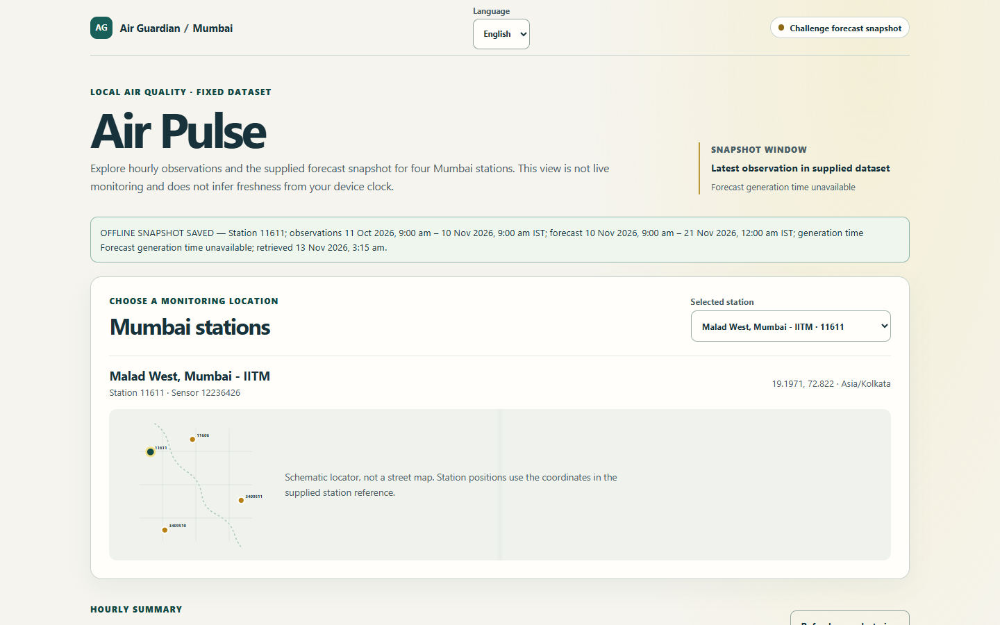
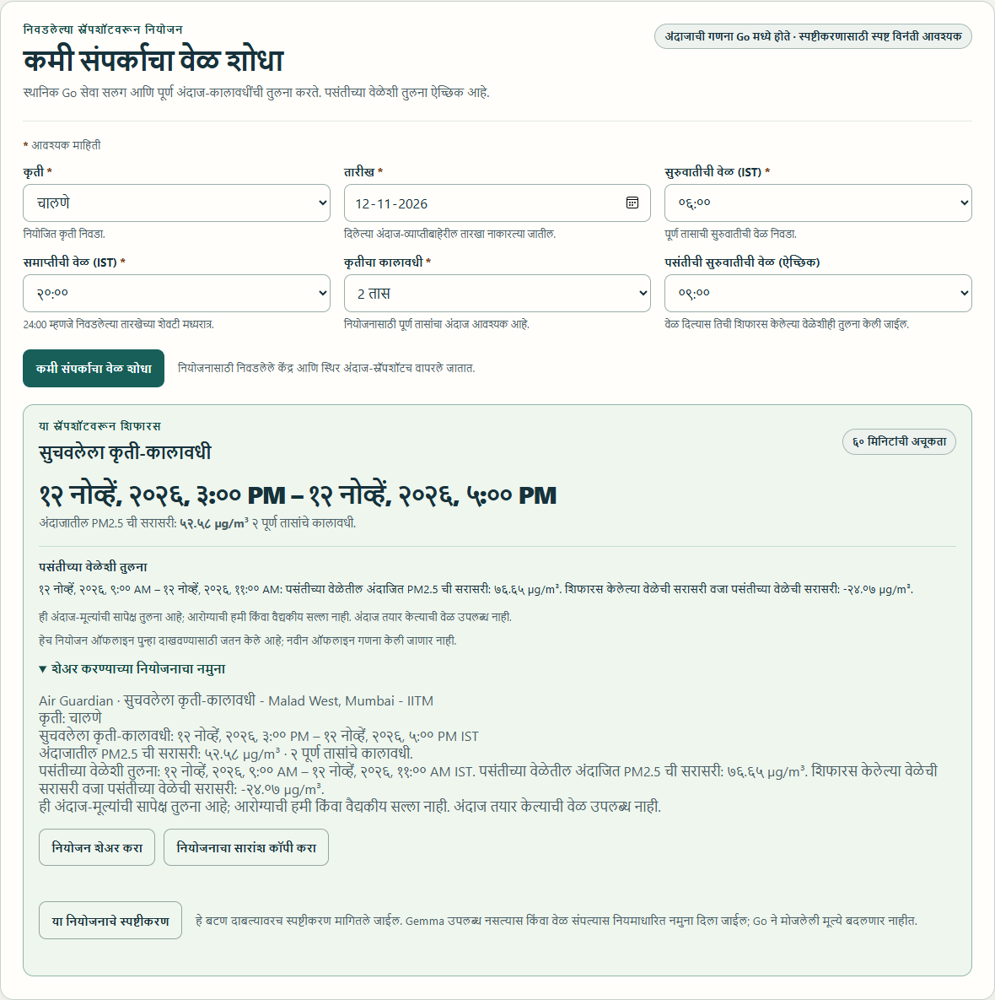
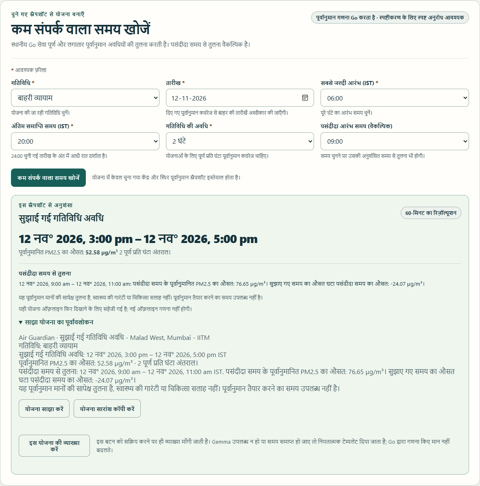
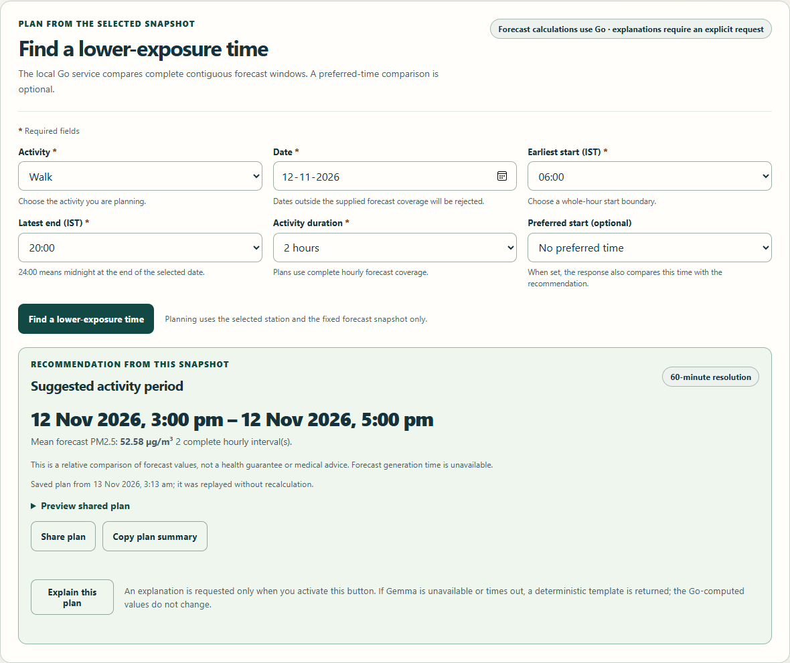
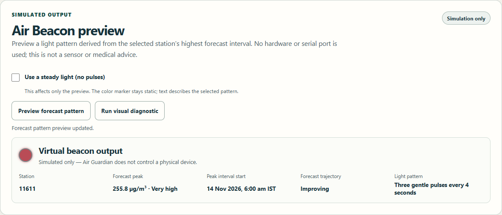

# Mumbai Air Guardian: Air Pulse

*A local, evidence-based activity planner for a fixed Mumbai air-quality forecast.*

- **Source code:** https://github.com/indcoder/mumbai-air-guardian
- **Submission document (PDF):** [`docs/Mumbai_Air_Guardian_Submission.pdf`](docs/Mumbai_Air_Guardian_Submission.pdf) — same content as the repository README.
- **Stack:** Go 1.27 API · Angular 22 PWA · local Google Gemma (`gemma4:e4b` via Ollama) · English, Marathi and Hindi · simulated Arduino UNO Q Air Beacon.

This is not live monitoring or medical advice. The latest supplied observation ends at **10 November 2026, 09:00 IST**. Forecast issuance time is unavailable. The selected forecast file has already been scaled by 1.10; the application does not scale it again.

**For judges:** the [Submission](#submission) section covers impact, novelty, functionality and the Google tools used, with screenshots. [Run locally](#run-locally-on-windows) explains how to reproduce the demo.

## Contents

- [Submission](#submission)
  - [Summary and problem](#project-summary)
  - [Impact](#impact) · [Novelty](#novelty) · [Demonstrated functionality](#demonstrated-functionality)
  - [Screenshots](#screenshots)
  - [Architecture and component roles](#architecture)
  - [Responsible-AI safeguards](#responsible-ai-safeguards) · [Provenance](#provenance) · [Limitations](#limitations)
  - [Two-minute judging pitch](#two-minute-judging-pitch)
- [Current capability status](#current-capability-status)
- [Prerequisites](#prerequisites) · [Run locally](#run-locally-on-windows) · [Verify](#verify)
- [Data and design notes](#data-and-design-notes) · [Project map](#project-map)

## Submission

### Project summary

Air Pulse is a local prototype for exploring the supplied air-quality observations and forecast snapshot for four Mumbai monitoring stations. The Angular interface presents interval-aware data and asks the Go service to compare complete forecast windows for a planned activity. It is not a live monitoring service or a source of medical advice.

### Problem

Air-quality datasets can be misread when observation intervals, forecast intervals, missing periods, scaling, and forecast issuance time are unclear. Air Pulse makes those boundaries visible and provides a consistent way to compare forecast periods without describing archived inputs as current conditions.

### Impact

**Potential impact; not measured:** the prototype is designed to help people in Mumbai inspect forecasts in their own language and choose a lower-exposure time for an outdoor activity such as a walk, a commute or children's play. No health outcome, behavior change, deployment reach, or real-world impact study has been measured. Recommendations are relative comparisons of forecast values, not health guarantees.

### Novelty

- **Interval-correct data handling:** forecast values are joined to the challenge interval reference, observation and forecast intervals stay distinct, gaps are retained rather than filled, and the already-applied 1.10 scaling is never repeated.
- **One authoritative planner:** every new plan is calculated by Go. Offline, the PWA replays an exact saved result rather than inventing a recommendation.
- **Guarded generative AI:** Gemma explains a plan only on request, its output is checked against the Go-computed evidence, and failures fall back to a labeled deterministic template.
- **Local-language access:** the full interface and deterministic explanations are available in English, Marathi and Hindi.
- **Ambient output concept:** a forecast-derived Air Beacon light pattern, designed for an Arduino UNO Q and currently simulated.

### Demonstrated functionality

- **IMPLEMENTED:** display observations and the selected forecast for four stations, with source and interval provenance.
- **IMPLEMENTED:** show an hourly chart, a tabular alternative, summary bands, and a near-term trajectory.
- **IMPLEMENTED:** calculate a lowest-forecast complete activity window in Go; an optional preferred start adds a comparison. The signed difference is the recommended mean minus the preferred mean.
- **IMPLEMENTED:** restore a validated offline snapshot and replay an exact saved plan without recalculation.
- **IMPLEMENTED:** English, Marathi, and Hindi interface resources and deterministic explanation fallbacks.
- **IMPLEMENTED:** share a plan through the operating-system share sheet or copy a plan summary; both were validated manually on Windows.
- **SIMULATED:** generate a forecast-derived Air Beacon preview and diagnostic pattern in memory; no device is controlled.
- **OPTIONAL:** a local English Gemma explanation passed the application's checks and was reviewed; failures use a labeled template.

### Screenshots

All screenshots were captured from the locally running application; files are in [`docs/submission-assets`](docs/submission-assets).

**Air Pulse overview** — fixed-snapshot labels, offline snapshot notice and station selection.  


**Air Outlook cards** — latest observation, forecast peak and minimum, and near-term trajectory, each with a text risk band.  


**Activity plan with local Gemma explanation** — Go-computed recommendation, preferred-time comparison, share preview and a reviewed English Gemma response.  


**Marathi activity plan** — localized controls, result and deterministic explanation.  


**Hindi activity plan**  


**Exact saved-plan replay while offline** — no recalculation without the Go service.  


**Air Beacon preview (simulation only)** — forecast-derived light pattern; no hardware is controlled.  


**Arduino UNO Q (hardware/setup evidence only)** — the powered board; its lights do not demonstrate control by Air Guardian. The radio-module label is redacted.  


Marathi and Hindi Air Beacon wording is shown in [`marathi-beacon-review.png`](docs/submission-assets/marathi-beacon-review.png) and [`hindi-beacon-review.png`](docs/submission-assets/hindi-beacon-review.png).

### Architecture

The Go service loads and validates the pinned local CSV inputs, exposes typed HTTP endpoints, and owns all new activity calculations. The Angular application displays the service responses and uses a production service worker plus browser storage for offline assets, validated snapshots, and exact saved-result replay. The optional explanation path calls a local Gemma model through Ollama and uses the output only when it passes validation; otherwise, the application reports and uses a deterministic template. Beacon output is an in-memory simulation.

| Layer | Responsibility |
| --- | --- |
| Pinned CSV inputs | Observations, interval reference, selected forecast, stations; SHA-256 and row counts checked at startup |
| Go API | Validation, outlook, activity planner, explanation evidence, beacon payloads |
| Local Gemma (Ollama) | Optional English plan explanation, validated before display |
| Angular PWA | Localized UI, chart/table, sharing, offline snapshot and exact plan replay |
| Air Beacon | Simulated forecast-derived light pattern; UNO Q integration planned |

#### Google Gemma role

The application requests English explanations from the local `gemma4:e4b` model through Ollama. After earlier timeouts and invalid output, a revised prompt produced reviewed responses that passed the application's checks through the API and the explicit browser action. One API response took about 16 seconds, within the 30-second limit. These samples do not guarantee future model output; timeouts or failed checks use a labeled template. Deterministic English, Marathi, and Hindi explanations remain available.

#### Go role

Go 1.27.4 is the local data-validation and API runtime. It computes activity recommendations and optional preferred-time comparisons, serves source/capability status, and derives simulated beacon payloads from validated forecast data. The browser does not implement a second planner.

#### Angular/PWA role

Angular 22 provides the localized Air Pulse interface, forms, chart/table views, and explicit explanation and beacon actions. The production service worker caches application assets; browser storage supports offline snapshot restoration and exact saved-result replay. The native share flow (operating-system share sheet) and plan-summary copy were validated manually.

A focused interface review used Modern Web Guidance CLI 1.0.0, whose stable release was [announced by Google's Chrome team on 10 November 2026](https://developer.chrome.com/blog/modern-web-guidance-v1). The tool provides web-platform guidance for coding agents; our review scope, checks and limitations are documented in [`docs/MODERN_WEB_REVIEW.md`](docs/MODERN_WEB_REVIEW.md). This is not a claim of a full accessibility audit.

#### Forecasting-pipeline role

The application consumes the author's `submission_xgb_corrected_scale_110.csv` forecast output from the competition. It does not retrain the model or run the competition's Python pipeline. The selected output already has 1.10 scaling applied; Air Pulse does not scale it again. Its forecast generation time is unavailable.

#### ClimateVerse role

The source configuration records ClimateVerse catalogue metadata (`10.71646/XXOBKO`, version `1.0`) as metadata-discovery provenance and lists Open-Meteo as the data provider. This is citation/provenance metadata, not a runtime ClimateVerse or weather-service connection. Weather context is disabled and **UNAVAILABLE**.

#### Arduino role

**SIMULATED:** the browser shows a static forecast-derived color marker and pattern description. A bounded v1 payload codec is documented and tested in Go ([`docs/BEACON_PROTOCOL.md`](docs/BEACON_PROTOCOL.md)). Arduino firmware, serial transport, device acknowledgment, and physical-device behavior are **PLANNED/OPTIONAL** and unverified.

A read-only Windows device-inventory check on 13 November 2026 detected the connected board as a USB composite device identifying as Uno Q, with its CDC serial and ADB interfaces reporting `OK`. This confirms host recognition only: no serial port was opened, no commands were sent, and no firmware was uploaded.

### Multilingual support

The interface and deterministic explanation templates support English, Marathi, and Hindi. The author reviewed the Marathi and Hindi introductions, activity-planning controls, results, deterministic explanations, preferred-time comparison and beacon wording, and approved overall language acceptance on 13 November 2026. Gemma generation is English-only.

### Responsible-AI safeguards

- The interface identifies the product as a fixed-dataset view and does not infer a forecast issue time from retrieval or device time.
- Explanations are requested only after an explicit user action; the Go-computed plan remains authoritative.
- Model output is validated against protected evidence tokens before use; unavailable or invalid generation uses an identified deterministic fallback.
- Values are rendered as text, and the interface repeatedly states that comparisons are not medical advice or health guarantees.
- No live weather, sensor readings, or physical beacon state is implied.

### Provenance

Startup validates the following pinned inputs:

| Input | Rows | SHA-256 |
| --- | ---: | --- |
| `Train.csv` | 48,400 | `8adbcf55315f166d7dc3dc1d3e4d7400651f26c1d8b95ff387eef38f4e70a283` |
| `submission_xgb_corrected_scale_110.csv` | 2,592 | `f82875f5f6ce820fafea9e53ef93298f3a21c29d514bbad9caec260f17c907d4` |
| `Test.csv` | 2,592 | `e7b9cc8859beb939276c958393e148adae55229c34f99dcb2555fe4ac13b28db` |
| `Stations.csv` | 4 | `383269fa04abf8f2eb49e5ec0bb5a77c2df11acb6aca996b7edf269a109ee9cf` |

Observation and forecast timestamp semantics are documented in [`docs/TIMESTAMP_SEMANTICS.md`](docs/TIMESTAMP_SEMANTICS.md).

### Limitations

- The app uses a fixed local dataset, not live monitoring or current readings.
- Forecast issuance time is not present in the input data.
- Data coverage is limited to the four supplied stations and forecast intervals.
- Weather context is disabled; no external weather feed is validated.
- Gemma may time out or return invalid output, and validation cannot guarantee every claim.
- Arduino firmware and physical transport are not implemented; the Air Beacon is a simulation.
- The competition data is not redistributed in this repository, so running the app requires obtaining it separately.
- The interface was built with accessibility in mind and accepted by the author, but it has not received a full professional accessibility audit; 28 automated contrast checks were inconclusive.
- The application is local-only; there is no public deployment.

### Two-minute judging pitch

Mumbai Air Guardian is a local prototype for exploring supplied air-quality data without confusing a fixed forecast with live conditions. Its Air Pulse interface presents observations and forecast intervals for four Mumbai stations, preserves missing intervals as gaps, and makes source and timing limitations visible. This matters because a timestamp embedded in a forecast identifier is not enough to determine what hour the value describes.

The demonstration follows four steps:

- **The data:** Forecast values are joined to the supplied interval reference, preserving missing intervals as gaps. The selected artifact is already scaled by 1.10 and is not scaled again.
- **The math:** Go deterministically finds the lowest-forecast-PM2.5 complete, contiguous activity window. A preferred-time comparison is optional and appears only when requested.
- **The explanation:** Local Gemma (`gemma4:e4b`) can explain the Go-computed result on request; it never calculates or selects the plan. Its response is checked against the computed evidence, with a labeled deterministic fallback if generation fails validation or times out.
- **The interface:** The Angular PWA and deterministic explanation templates support English, Marathi, and Hindi. If Go is unavailable, the app can restore a validated local snapshot and replay an exact saved plan; it cannot create a new offline recommendation. Gemma explanations require Ollama to be running.

Air Beacon is a forecast-derived visual simulation; no physical device is integrated with or controlled by the app. The contribution demonstrated here is careful interval interpretation, transparent provenance, and a reproducible local comparison—not a medical recommendation, a live-monitoring claim, or measured health impact.

## Current capability status

| Capability | Status |
| --- | --- |
| Four-station observations and forecast snapshot | IMPLEMENTED |
| Hourly outlook, trend, chart and interval-table alternative | IMPLEMENTED |
| Activity planning from complete contiguous hourly forecast coverage | IMPLEMENTED |
| Preferred-time comparison | IMPLEMENTED, optional |
| New activity calculations when the Go service is offline | UNAVAILABLE |
| Live air monitoring and forecast issuance timestamp | UNAVAILABLE |
| User-triggered English, Marathi and Hindi explanations with localized fallbacks | IMPLEMENTED; Gemma generation remains English-only |
| Validated output from local Gemma | OPTIONAL; English sample verified locally; timeout or invalid output uses a template |
| English/Marathi/Hindi interface localization | IMPLEMENTED; wording accepted by the project owner |
| Offline snapshot storage and exact saved-plan replay | IMPLEMENTED; production browser snapshot restore and exact replay verified |
| Plan sharing and copy controls | IMPLEMENTED; native share sheet and clipboard copy verified manually on Windows |
| Air Beacon preview | SIMULATED; no physical device control or serial transport |

When no preferred start time is supplied, the planner returns the lowest-forecast valid period and omits the comparison. The browser does not implement a second planner.

## Prerequisites

- Go **1.27.4** for the backend.
- Node.js **22.22.3 or later in the 22.x line** and npm **10.9.9** for Angular 22.
- The original competition input files, unchanged, in a `zindi_artifacts\` folder at the project root.

### Input data is not included

The competition data files are **not redistributed in this repository** because redistribution rights have not been confirmed. Obtain them from the Mumbai air-quality competition on Zindi and place these files, unchanged, in `zindi_artifacts\`:

- `Train.csv`, `Test.csv`, `Stations.csv` — competition data.
- `submission_xgb_corrected_scale_110.csv` — the author's selected forecast output (already scaled by 1.10).

The API refuses to start if any file is missing or its SHA-256 digest or row count differs from `config\sources.yaml`. Screenshots in [`docs\submission-assets`](docs/submission-assets) show the running application.

## Run locally on Windows

Open two PowerShell windows from the project root.

In the first window, start the API:

```powershell
$go = Join-Path $env:LOCALAPPDATA 'Programs\Go\go1.27.4\go\bin\go.exe'
Push-Location .\backend
$env:AIR_GUARDIAN_DATA_ROOT = (Resolve-Path ..).Path
& $go run .\cmd\air-guardian
```

The API listens on `127.0.0.1:8080`. Startup validates the configured input paths, row counts, schemas and SHA-256 digests. Leave this window running.

For English Gemma explanations, run the existing local Ollama service with `gemma4:e4b` installed. The API defaults to `http://localhost:11434` and a 30-second limit; if generation fails, it returns a labeled template instead. Ollama is not required for activity planning.

In the second window, install frontend dependencies once and start Angular:

```powershell
$node = Join-Path $env:LOCALAPPDATA 'Programs\node-v22.23.5\node.exe'
$npmCli = Join-Path (Split-Path $node) 'node_modules\npm\bin\npm-cli.js'
Push-Location .\frontend
& $node $npmCli ci
& $node .\node_modules\@angular\cli\bin\ng.js serve
```

Open `http://localhost:4200/`. The frontend runtime configuration points to the local API at `http://localhost:8080`. Use a supported Node version before running `npm ci`; Angular rejects unsupported Node versions.

Stop either development server with `Ctrl+C`.

## Verify

From `backend` (with the `$go` variable from the API command):

```powershell
& $go test -count=1 ./...
& $go vet ./...
& $go build ./...
```

From `frontend` (with the `$node` variable from the Angular command):

```powershell
& $node .\node_modules\@angular\cli\bin\ng.js build
& $node .\node_modules\@angular\cli\bin\ng.js test --watch=false
```

The variables above use the verified user-local Go 1.27.4 and Node 22.23.5 paths in this environment. If installed elsewhere, update them to point to a compatible Go executable and Node runtime.

## Data and design notes

- `config\sources.yaml` names the observation, Test interval-reference, selected forecast and station files and pins their expected hashes and row counts.
- Observation timestamps and timestamps embedded in forecast IDs denote interval ends. Forecasts are joined to `Test.csv` by ID; see [`docs\TIMESTAMP_SEMANTICS.md`](docs/TIMESTAMP_SEMANTICS.md).
- Source-flagged observations remain visible for diagnosis but are excluded from ordinary summaries.
- All source dates and times use `Asia/Kolkata`. Missing intervals remain gaps; the planner requires complete contiguous hourly coverage.
- Beacon output is a virtual preview only. It derives its pattern and peak interval from the selected station's verified forecast; no physical device, serial transport, or Arduino firmware is connected. See [`docs\BEACON_PROTOCOL.md`](docs/BEACON_PROTOCOL.md) for the versioned payload contract and implementation boundary. Weather context remains unavailable.
- Explanations are requested only after selecting **Explain this plan**; English, Marathi and Hindi templates are available, while Gemma generation is English-only. A local English response has passed the application's checks and been reviewed; those checks cannot guarantee every model claim is correct.
- The interface is built with accessibility in mind, but this implementation has not received a full professional accessibility audit. See [`docs\MODERN_WEB_REVIEW.md`](docs/MODERN_WEB_REVIEW.md) for completed checks and remaining manual testing.

## Project map

- `backend\` — Go ingestion, outlook, planner and HTTP API.
- `frontend\` — Angular application and tests.
- `config\` — pinned source and outlook configuration.
- `docs\` — timestamp, beacon protocol boundary and focused web-accessibility review.
- `zindi_artifacts\` — competition inputs (not committed; see [Input data is not included](#input-data-is-not-included)).

The app and demo are local-development artifacts; production hosting and live-data integrations are not included.
