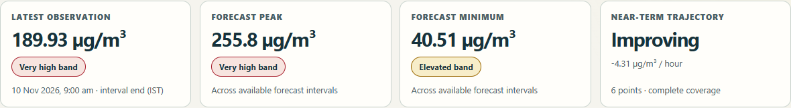
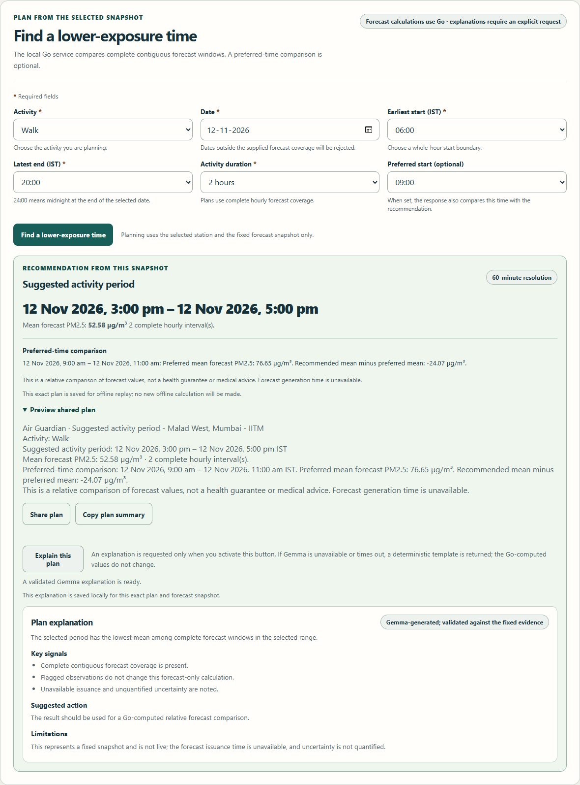

# Mumbai Air Guardian

*A multilingual air-quality decision companion for Mumbai.*

From air-quality forecasts to decisions people can understand and act on.

- **Judge-focused submission (PDF):** [`docs/Mumbai_Air_Guardian_Submission.pdf`](docs/Mumbai_Air_Guardian_Submission.pdf) — concise visual narrative, separate from the technical README.
- **Public hackathon demo:** [https://air.hackmum.in](https://air.hackmum.in)
- **Source code and reproducibility:** [https://github.com/indcoder/mumbai-air-guardian](https://github.com/indcoder/mumbai-air-guardian)
- **Product:** Air Pulse, the forecast experience within Mumbai Air Guardian.

The public demo is provided for challenge evaluation and may be temporarily unavailable while deployment or maintenance is in progress, or restricted/taken offline in response to unexpected traffic or abuse. The GitHub repository remains the durable source and reproducibility artifact.

Mumbai Air Guardian turns the supplied Mumbai PM2.5 forecast snapshot into a decision experience: people can inspect observations and forecasts, compare complete activity windows, request a grounded explanation, use the interface in English, Marathi or Hindi, and share a plan. Its Air Beacon explores how a forecast state could be presented as an ambient signal.

This is a fixed challenge-data snapshot, not live monitoring or medical advice. The forecast issuance time is unavailable; the selected forecast artifact has already been scaled by 1.10 and is not scaled again.

**For judges:** the [Submission](#submission) section covers impact, novelty, functionality and the Google tools used, with screenshots. [Run locally](#run-locally-on-windows) explains how to reproduce the demo.

## Contents

- [Submission](#submission)
  - [Summary and problem](#project-summary)
  - [Malad West example](#what-air-guardian-actually-does)
  - [Impact](#impact) · [What makes it different](#what-makes-it-different) · [Demonstrated functionality](#demonstrated-functionality)
  - [Screenshots](#screenshots)
  - [Google Gemma role](#google-gemma-4) · [ClimateVerse context](#climateverse-discovering-the-context)
  - [Multilingual experience](#multilingual-experience) · [Architecture](#architecture)
  - [Responsible-AI safeguards](#responsible-ai-safeguards) · [Provenance](#provenance) · [Limitations](#limitations)
  - [Two-minute judging pitch](#two-minute-judging-pitch)
- [Current capability status](#current-capability-status)
- [Prerequisites](#prerequisites) · [Run locally](#run-locally-on-windows) · [Verify](#verify)
- [Data and design notes](#data-and-design-notes) · [Project map](#project-map)

## Submission

### Project summary

Mumbai Air Guardian transforms the challenge's supplied PM2.5 forecast into a multilingual decision experience. Air Pulse presents observations and forecast intervals for four Mumbai stations; the Go planner compares complete forecast windows for a planned activity. The result is a relative comparison of forecast values, not a health guarantee.

#### Problem

Forecast numbers alone do not show which complete activity window is relatively lower, why it was selected, or how the result can be understood in a local language. Air Pulse keeps observation and forecast intervals distinct, preserves gaps, and makes data-source and timing limits visible.

### What Air Guardian actually does

**Verified example — Malad West, 12 November 2026**

- Activity duration: **2 hours**
- Preferred period, **08:00–10:00 IST**: mean predicted PM2.5 **86.15 µg/m³**
- Lower-forecast option, **15:00–17:00 IST**: mean predicted PM2.5 **52.58 µg/m³**
- Difference: **33.57 µg/m³ lower** than the preferred period

The Go planner calculates this recommendation deterministically from the supplied hourly forecast. Gemma may explain that result but cannot change forecast values or select the recommended period. The source-backed regression test records the full-precision values in [`planner_test.go`](backend/internal/activity/planner_test.go). A lower forecast value is not a claim that a period is safe or healthy.

### Impact

Mumbai Air Guardian makes supplied air-quality forecasts easier to understand and act on. Rather than requiring someone to interpret a PM2.5 time series manually, it identifies relatively lower-forecast periods for activities such as walking, commuting, children's outdoor time and community events. The English, Marathi and Hindi interface broadens who can use the experience. Recommendations are transparent comparisons, not health guarantees; the application makes snapshot age, station coverage and forecast limitations visible. This prototype has not been evaluated for behavior change, deployment reach or health outcomes.

### What makes it different

Most air-quality tools stop at a number, map or chart. Mumbai Air Guardian connects:

**Forecast → Evidence → Explanation → Decision → Ambient Signal**

- **Forecast:** the selected challenge artifact provides the quantitative PM2.5 values.
- **Evidence:** Go joins forecasts to the supplied interval and station data, preserving gaps and source boundaries.
- **Explanation:** Google Gemma can explain Go-computed evidence when explicitly requested; it does not predict PM2.5.
- **Decision:** the deterministic Go planner finds a relatively lower-forecast complete activity window.
- **Ambient signal:** the Air Beacon simulation explores a color-and-pattern representation; physical device control is not implemented.

The interface also supports English, Marathi and Hindi, exact saved-plan replay while offline, and plan sharing.

### Demonstrated functionality

- **IMPLEMENTED:** display observations and the selected forecast for four stations, with source and interval provenance.
- **IMPLEMENTED:** show an hourly chart, a tabular alternative, summary bands, and a near-term trajectory.
- **IMPLEMENTED:** calculate the lowest-forecast complete activity window in Go; an optional preferred start adds a comparison. The signed difference is the recommended mean minus the preferred mean.
- **IMPLEMENTED:** restore a validated offline snapshot and replay an exact saved plan without recalculation.
- **IMPLEMENTED:** English, Marathi, and Hindi interface resources and deterministic explanation fallbacks.
- **IMPLEMENTED:** share a plan through the operating-system share sheet or copy a plan summary; both were validated manually on Windows.
- **SIMULATED:** generate a forecast-derived Air Beacon preview and diagnostic pattern in memory; no device is controlled.
- **IMPLEMENTED locally:** English Gemma integration and a reviewed generated response through Ollama; runtime availability depends on the local Ollama service. Failure uses a labeled deterministic template.

### Screenshots

All screenshots were captured from the locally running application; files are in [`docs/submission-assets`](docs/submission-assets).

**Air Pulse overview** — fixed-snapshot labels, offline snapshot notice and station selection.  


**Air Outlook cards** — latest observation, forecast peak and minimum, and near-term trajectory, each with a text risk band.  


**Activity plan with local Gemma explanation** — Go-computed recommendation, preferred-time comparison, share preview and a reviewed English Gemma response.  


**Marathi activity plan** — localized controls, result and deterministic explanation.  


**Hindi activity plan**  


**Exact saved-plan replay while offline** — no recalculation without the Go service.  


**Air Beacon preview (simulation only)** — forecast-derived light pattern; no hardware is controlled.  


**Arduino UNO Q (hardware direction / prototype target)** — the powered board is host-recognized only; its lights do not demonstrate control by Air Guardian. The radio-module label is redacted.<br>


Marathi and Hindi Air Beacon wording is shown in [`marathi-beacon-review.png`](docs/submission-assets/marathi-beacon-review.png) and [`hindi-beacon-review.png`](docs/submission-assets/hindi-beacon-review.png).

### Architecture

The Go service loads and validates the pinned local CSV inputs, exposes typed HTTP endpoints, and owns all new activity calculations. The Angular application displays the service responses and uses a production service worker plus browser storage for offline assets, validated snapshots, and exact saved-result replay. The optional explanation path calls a local Gemma model through Ollama and uses the output only when it passes validation; otherwise, the application reports and uses a deterministic template. Beacon output is an in-memory simulation.

| Layer | Responsibility |
| --- | --- |
| Pinned CSV inputs | Observations, interval reference, selected forecast, stations; SHA-256 and row counts checked at startup |
| Go API | Validation, outlook, activity planner, explanation evidence, beacon payloads |
| Local Gemma (Ollama) | User-triggered English explanation; runtime depends on Ollama |
| Angular PWA | Localized UI, chart/table, sharing, offline snapshot and exact plan replay |
| Air Beacon | Simulated forecast-derived light pattern; physical device control is not implemented |

### Google Gemma 4

Google Gemma 4 is the grounded explanation layer. The application sends a bounded evidence package, derived from the supplied forecast and deterministic Go calculations, to local `gemma4:e4b` through Ollama only after the user requests an explanation. Gemma does **not** predict or modify PM2.5, select an activity period, create measurements, or replace the planner. An English response has been generated and reviewed locally; future generations are not guaranteed to pass validation. Invalid or timed-out output is replaced with a labeled deterministic template. Gemma generation in Marathi and Hindi is not implemented; those languages use deterministic localized templates.

### ClimateVerse: discovering the context

Project provenance notes record a ClimateVerse India catalogue entry for Open-Meteo (DOI `10.71646/XXOBKO`, version `1.0`); the configuration lists Open-Meteo as the data provider. This is catalogue/discovery metadata, not a runtime ClimateVerse API or evidence that ClimateVerse generated the weather data or the selected PM2.5 forecast. The selected forecast's historical acquisition path through ClimateVerse is unverified. Weather context that cannot be validated remains unavailable.

#### Go role

Go 1.27.4 is the local data-validation and API runtime. It computes activity recommendations and optional preferred-time comparisons, serves source/capability status, and derives simulated beacon payloads from validated forecast data. The browser does not implement a second planner.

#### Angular/PWA role

Angular 22 provides the localized Air Pulse interface, forms, chart/table views, and explicit explanation and beacon actions. The production service worker caches application assets; browser storage supports offline snapshot restoration and exact saved-result replay. The native share flow (operating-system share sheet) and plan-summary copy were validated manually.

Modern Web Guidance 1.0, [announced by Google's Chrome team](https://developer.chrome.com/blog/modern-web-guidance-v1), informed the Angular frontend review workflow for modern web-platform patterns, compatibility, accessibility and implementation quality. Findings and limitations are recorded in [`docs/MODERN_WEB_REVIEW.md`](docs/MODERN_WEB_REVIEW.md); this is not a claim of a full accessibility audit or judging points.

#### Forecasting-pipeline role

The application consumes the author's `submission_xgb_corrected_scale_110.csv` forecast output from the competition. It does not retrain the model or run the competition's Python pipeline. The selected output already has 1.10 scaling applied; Air Pulse does not scale it again. Its forecast generation time is unavailable.

#### Arduino role

**SIMULATED:** the browser shows a static forecast-derived color marker and pattern description. A bounded v1 payload codec is documented and tested in Go ([`docs/BEACON_PROTOCOL.md`](docs/BEACON_PROTOCOL.md)). Arduino firmware, serial transport, device acknowledgment, and physical-device behavior are **NOT IMPLEMENTED**.

A read-only Windows device-inventory check on 13 November 2026 detected the connected board as a USB composite device identifying as Uno Q. This confirms host recognition only: no serial port was opened, no commands were sent, and no firmware was uploaded.

### Multilingual experience

The interface and deterministic explanation templates support English, Marathi, and Hindi. The author reviewed the Marathi and Hindi introductions, activity-planning controls, results, deterministic explanations, preferred-time comparison and beacon wording, and approved overall language acceptance on 13 November 2026. Gemma generation is English-only.

### Responsible-AI safeguards

- The interface identifies the product as a fixed-dataset view and does not infer a forecast issue time from retrieval or device time.
- Explanations are requested only after an explicit user action; the Go-computed plan remains authoritative.
- Model output is validated against protected evidence tokens before use; unavailable or invalid generation uses an identified deterministic fallback.
- Values are rendered as text, and the interface repeatedly states that comparisons are not medical advice or health guarantees.
- No live weather, sensor readings, or physical beacon state is implied.

### Provenance

Startup validates the following pinned inputs:

| Input | Rows | SHA-256 |
| --- | ---: | --- |
| `Train.csv` | 48,400 | `8adbcf55315f166d7dc3dc1d3e4d7400651f26c1d8b95ff387eef38f4e70a283` |
| `submission_xgb_corrected_scale_110.csv` | 2,592 | `f82875f5f6ce820fafea9e53ef93298f3a21c29d514bbad9caec260f17c907d4` |
| `Test.csv` | 2,592 | `e7b9cc8859beb939276c958393e148adae55229c34f99dcb2555fe4ac13b28db` |
| `Stations.csv` | 4 | `383269fa04abf8f2eb49e5ec0bb5a77c2df11acb6aca996b7edf269a109ee9cf` |

Observation and forecast timestamp semantics are documented in [`docs/TIMESTAMP_SEMANTICS.md`](docs/TIMESTAMP_SEMANTICS.md).

### Limitations

- The app uses a fixed local dataset, not live monitoring or current readings.
- Forecast issuance time is not present in the input data.
- Data coverage is limited to the four supplied stations and forecast intervals.
- Weather context is disabled; no external weather feed is validated.
- Gemma may time out or return invalid output, and validation cannot guarantee every claim.
- Arduino firmware and physical transport are not implemented; the Air Beacon is a simulation.
- The competition data is not redistributed in this repository, so running the app requires obtaining it separately.
- The interface was built with accessibility in mind and accepted by the author, but it has not received a full professional accessibility audit; 28 automated contrast checks were inconclusive.
- Weather context is unavailable; the listed ClimateVerse metadata does not establish that it was used to generate or acquire the selected forecast.

### Two-minute judging pitch

“Mumbai Air Guardian asks a question beyond the forecasting challenge: once we can predict air quality, what can someone actually do with that prediction?

Take Malad West on 12 November. A preferred two-hour window from 08:00 to 10:00 has a mean predicted PM2.5 of 86.15 µg/m³. The deterministic Go planner identifies 15:00 to 17:00 at 52.58 µg/m³, 33.57 µg/m³ lower among the available complete forecast windows.

Go calculates. AI does not choose the time. Local Google Gemma 4 can explain the evidence when requested, with validation and a deterministic fallback rather than changing the forecast. The interface is available in English, Marathi and Hindi.

Project metadata records ClimateVerse as a dataset-discovery and provenance reference, separately from Open-Meteo, the listed data provider. The Angular PWA can replay an exact saved plan offline, and the simulated Air Beacon explores an accessible ambient signal.

Mumbai Air Guardian moves from forecast, to evidence, to explanation, to decision, and ultimately to action.”

## Current capability status

| Capability | Status |
| --- | --- |
| Four-station observations and forecast snapshot | IMPLEMENTED |
| Hourly outlook, trend, chart and interval-table alternative | IMPLEMENTED |
| Activity planning from complete contiguous hourly forecast coverage | IMPLEMENTED |
| Preferred-time comparison | IMPLEMENTED, optional |
| New activity calculations when the Go service is offline | UNAVAILABLE |
| Live air monitoring and forecast issuance timestamp | UNAVAILABLE |
| User-triggered explanations with deterministic English/Marathi/Hindi templates | IMPLEMENTED |
| Local Google Gemma integration | IMPLEMENTED; runtime availability depends on Ollama |
| Verified English Gemma generation | IMPLEMENTED locally; a reviewed sample passed application checks |
| Gemma Marathi/Hindi generation | NOT IMPLEMENTED |
| Deterministic English/Marathi/Hindi explanations | IMPLEMENTED |
| English/Marathi/Hindi interface localization | IMPLEMENTED; wording accepted by the project owner |
| Offline snapshot storage and exact saved-plan replay | IMPLEMENTED; production browser snapshot restore and exact replay verified |
| Plan sharing and copy controls | IMPLEMENTED; native share sheet and clipboard copy verified manually on Windows |
| Air Beacon preview | SIMULATED; no physical device control or serial transport |
| Physical Arduino UNO Q control | NOT IMPLEMENTED; board was host-recognized only |
When no preferred start time is supplied, the planner returns the lowest-forecast valid period and omits the comparison. The browser does not implement a second planner.

## Prerequisites

- Go **1.27.4** for the backend.
- Node.js **22.22.3 or later in the 22.x line** and npm **10.9.9** for Angular 22.
- The original competition input files, unchanged, in a `zindi_artifacts\` folder at the project root.

### Input data is not included

The competition data files are **not redistributed in this repository** because redistribution rights have not been confirmed. Obtain them from the Mumbai air-quality competition on Zindi and place these files, unchanged, in `zindi_artifacts\`:

- `Train.csv`, `Test.csv`, `Stations.csv` — competition data.
- `submission_xgb_corrected_scale_110.csv` — the author's selected forecast output (already scaled by 1.10).

The API refuses to start if any file is missing or its SHA-256 digest or row count differs from `config\sources.yaml`. Screenshots in [`docs\submission-assets`](docs/submission-assets) show the running application.

## Run locally on Windows

Open two PowerShell windows from the project root.

In the first window, start the API:

```powershell
$go = Join-Path $env:LOCALAPPDATA 'Programs\Go\go1.27.4\go\bin\go.exe'
Push-Location .\backend
$env:AIR_GUARDIAN_DATA_ROOT = (Resolve-Path ..).Path
& $go run .\cmd\air-guardian
```

The API listens on `127.0.0.1:8080`. Startup validates the configured input paths, row counts, schemas and SHA-256 digests. Leave this window running.

For English Gemma explanations, run the existing local Ollama service with `gemma4:e4b` installed. The API defaults to `http://localhost:11434` and a 30-second limit; if generation fails, it returns a labeled template instead. Ollama is not required for activity planning.

In the second window, install frontend dependencies once and start Angular:

```powershell
$node = Join-Path $env:LOCALAPPDATA 'Programs\node-v22.23.5\node.exe'
$npmCli = Join-Path (Split-Path $node) 'node_modules\npm\bin\npm-cli.js'
Push-Location .\frontend
& $node $npmCli ci
& $node .\node_modules\@angular\cli\bin\ng.js serve
```

Open `http://localhost:4200/`. The frontend runtime configuration points to the local API at `http://localhost:8080`. Use a supported Node version before running `npm ci`; Angular rejects unsupported Node versions.

Stop either development server with `Ctrl+C`.

## Verify

From `backend` (with the `$go` variable from the API command):

```powershell
& $go test -count=1 ./...
& $go vet ./...
& $go build ./...
```

From `frontend` (with the `$node` variable from the Angular command):

```powershell
& $node .\node_modules\@angular\cli\bin\ng.js build
& $node .\node_modules\@angular\cli\bin\ng.js test --watch=false
```

The variables above use the verified user-local Go 1.27.4 and Node 22.23.5 paths in this environment. If installed elsewhere, update them to point to a compatible Go executable and Node runtime.

## Data and design notes

- `config\sources.yaml` names the observation, Test interval-reference, selected forecast and station files and pins their expected hashes and row counts.
- Observation timestamps and timestamps embedded in forecast IDs denote interval ends. Forecasts are joined to `Test.csv` by ID; see [`docs\TIMESTAMP_SEMANTICS.md`](docs/TIMESTAMP_SEMANTICS.md).
- Source-flagged observations remain visible for diagnosis but are excluded from ordinary summaries.
- All source dates and times use `Asia/Kolkata`. Missing intervals remain gaps; the planner requires complete contiguous hourly coverage.
- Beacon output is a virtual preview only. It derives its pattern and peak interval from the selected station's verified forecast; no physical device, serial transport, or Arduino firmware is connected. See [`docs\BEACON_PROTOCOL.md`](docs/BEACON_PROTOCOL.md) for the versioned payload contract and implementation boundary. Weather context remains unavailable.
- Explanations are requested only after selecting **Explain this plan**; English, Marathi and Hindi templates are available, while Gemma generation is English-only. A local English response has passed the application's checks and been reviewed; those checks cannot guarantee every model claim is correct.
- The interface is built with accessibility in mind, but this implementation has not received a full professional accessibility audit. See [`docs\MODERN_WEB_REVIEW.md`](docs/MODERN_WEB_REVIEW.md) for completed checks and remaining manual testing.

## Project map

- `backend\` — Go ingestion, outlook, planner and HTTP API.
- `frontend\` — Angular application and tests.
- `config\` — pinned source and outlook configuration.
- `docs\` — timestamp, beacon protocol boundary, focused web review and judge-PDF source.
- `zindi_artifacts\` — competition inputs (not committed; see [Input data is not included](#input-data-is-not-included)).

The application uses a fixed local challenge snapshot; live-data integrations are not included. The challenge inputs are excluded from this public repository pending confirmation of redistribution rights.
